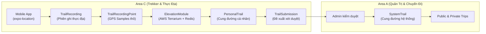
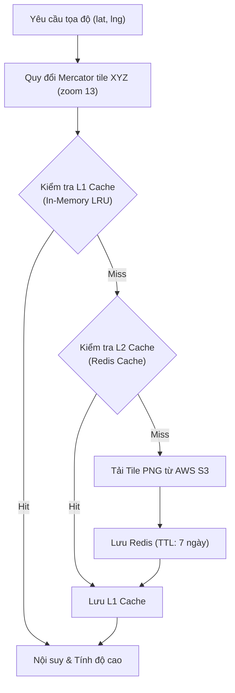
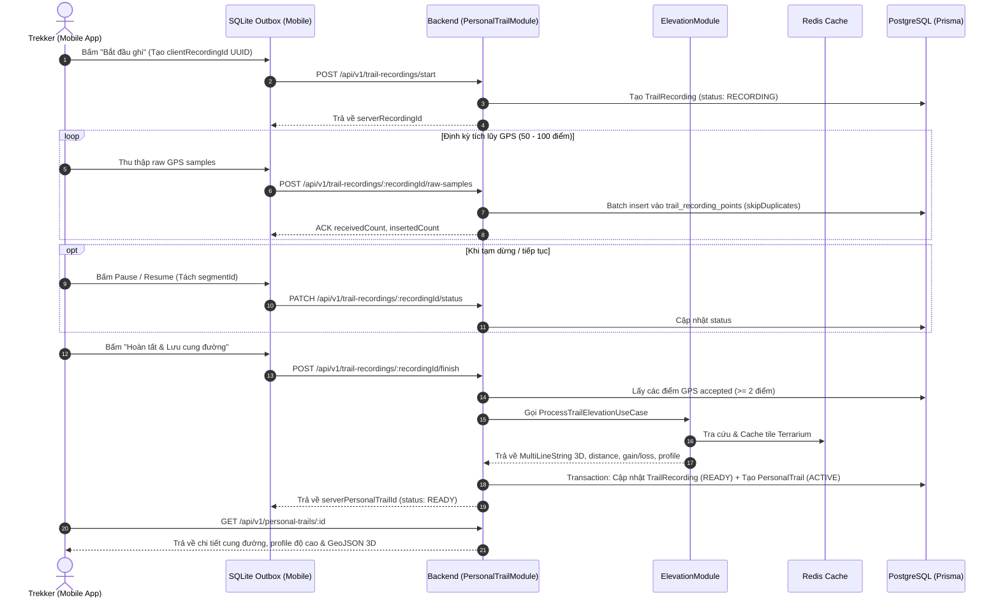

# Hướng Dẫn Nghiệp Vụ & Sử Dụng API: Personal Trail & Elevation Processing (Area C)

Tài liệu này đặc tả toàn bộ nghiệp vụ, luồng hoạt động thực địa (Offline-first), cơ chế nắn chỉnh mô hình số độ cao vệ tinh (AWS Terrarium DEM) kết hợp Redis Cache, và hướng dẫn chi tiết cách gọi từng API endpoint của hai module **Personal Trail** và **Elevation** thuộc **Area C** trong hệ thống **Vina_TrekGO**.

---

## 📌 1. Tổng Quan & Phạm Vi Nghiệp Vụ (Area C)

Trong hệ sinh thái TrekGO, **Area C (do Luật phụ trách)** chịu trách nhiệm về:
- **Authentication**: Xác thực danh tính người dùng (Supabase Auth integration).
- **GPS & Bản Đồ 3D**: Trải nghiệm thực địa, ghi vết GPS hành trình, cảnh báo lệch tuyến, trắc địa và mô hình số độ cao vệ tinh (DEM).

### Phân Định Trách Nhiệm Về Tuyến Đường:


- **`PersonalTrail`**: Cung đường do chính Trekker tự ghi lại qua GPS thực tế. Thuộc quyền sở hữu cá nhân (`userId`), có thể giữ riêng tư (`PRIVATE`) hoặc chia sẻ (`SHARED`). Không chứa điểm mốc hệ thống giả lập.
- **`TrailSubmission`**: Khi Trekker muốn cung đường của mình xuất hiện trên bản đồ chung của TrekGO (Explore), họ gửi yêu cầu duyệt. Khi Admin duyệt thành công, cung đường sẽ được nhân bản thành **`SystemTrail`** (thuộc Area A).

---

## 🛰️ 2. Mô Hình Số Độ Cao Vệ Tinh (AWS Terrarium DEM) & Redis Cache

### 2.1. Tại sao cần AWS Terrarium DEM?
Độ cao GPS thu nhận từ chip điện thoại (`altitudeM`) thường có sai số dọc (Vertical Error) rất lớn (thường lệch từ $\pm 15\text{m}$ đến $\pm 50\text{m}$ tùy địa hình rừng núi hoặc thung lũng che khuất vệ tinh). Do đó, hệ thống sử dụng **AWS Terrain Tiles (Terrarium format)** để nắn chuẩn hóa lại độ cao thực địa:
- **Không ghi đè GPS gốc**: Trường `altitudeM` trong `trail_recording_points` vẫn giữ nguyên giá trị cảm biến của máy để phục vụ đối soát.
- **Tạo GeoJSON 3D**: Tọa độ chuẩn hóa được đóng gói vào `processedGeojson` dưới dạng `MultiLineString` với mỗi điểm gồm 3 chiều: `[longitude, latitude, elevation]`.

### 2.2. Công Thức Giải Mã RGB Terrarium
Mỗi tile bản đồ vệ tinh là một ảnh PNG kích thước $256 \times 256$ pixel. Độ cao thực tế được mã hóa vào 3 kênh màu Red (R), Green (G), Blue (B):
$$\text{Elevation (meters)} = R \times 256 + G + \frac{B}{256} - 32768$$

### 2.3. Nội Suy Song Tuyến Tính (Bilinear Interpolation)
Tọa độ GPS hiếm khi rơi chính xác vào tâm 1 pixel của tile vệ tinh zoom 13. Backend áp dụng thuật toán nội suy từ 4 pixel lân cận $(x_0, y_0), (x_1, y_0), (x_0, y_1), (x_1, y_1)$ dựa trên tỷ lệ sai lệch vị trí $(u, v)$ để đảm bảo mặt cắt độ cao mượt mà, không bị răng cưa bậc thang.

### 2.4. Thuật Toán Lọc Nhiễu Hysteresis (Elevation Gain/Loss)
Để tính tổng độ dốc leo lên (`elevationGainM`) và dốc đi xuống (`elevationLossM`), thuật toán áp dụng ngưỡng trễ (Hysteresis Threshold $= 5\text{m}$):
- Các dao động nhỏ hơn $5\text{m}$ do rung lắc GPS khi người dùng dừng chân nghỉ sẽ bị bỏ qua (không tích lũy sai số giả).
- Khi gặp đoạn mất tín hiệu GPS (NoData / gap), mốc so sánh (`anchor`) sẽ tự động reset để không cộng dồn bước nhảy đột ngột.

### 2.5. Cơ Chế Bộ Đệm 2 Tầng (Two-Tier Cache)

- **L1 (In-Memory LRU)**: Lưu các tile vừa giải mã ngay trên RAM Node.js để tái sử dụng tức thì cho các điểm GPS kề nhau.
- **L2 (Redis Cache)**: Lưu buffer ảnh PNG gốc tải từ AWS với khóa `dem:terrarium:{zoom}:{x}:{y}` và thời gian sống (TTL) 7 ngày.
- **Graceful Fallback**: Nếu Redis bị tắt hoặc chưa bật (`REDIS_ENABLED=false`), hệ thống tự động fallback về In-Memory cache, đảm bảo không làm gián đoạn trải nghiệm người dùng.

---

## 🔄 3. Vòng Đời Thực Địa Offline-First (Mobile $\to$ Backend)

Ứng dụng Mobile hoạt động theo cơ chế **Offline-First**: người dùng có thể bắt đầu, tạm dừng và ghi GPS ngay cả khi mất sóng điện thoại giữa rừng. Dữ liệu được đẩy lên server qua hàng đợi SQLite Outbox khi có mạng trở lại.



---

## 📖 4. Hướng Dẫn Sử Dụng Chi Tiết Các API Endpoint

Tất cả các API yêu cầu header xác thực:
```http
Authorization: Bearer <JWT_ACCESS_TOKEN>
Content-Type: application/json
```

---

### 4.1. Khởi Tạo Phiên Ghi (Start Recording Session)
Ghi nhận phiên ghi mới trên server. Hỗ trợ Idempotency: nếu Mobile gọi lại với cùng `clientRecordingId`, Backend sẽ trả về bản ghi cũ mà không tạo bản ghi mới trùng lặp.

- **Method**: `POST`
- **URL**: `http://localhost:3000/api/v1/trail-recordings/start`
- **Request Body**:
```json
{
  "clientRecordingId": "9b1deb4d-3b7d-4bad-9bdd-2b0d7b3dcb6d",
  "startedAt": "2026-10-15T14:30:00.000Z",
  "deviceInfo": {
    "platform": "ios",
    "osVersion": "18.1",
    "deviceModel": "iPhone 15 Pro"
  }
}
```
- **Response mẫu (`201 Created` hoặc `200 OK`)**:
```json
{
  "success": true,
  "data": {
    "serverRecordingId": "22222222-2222-2222-2222-222222222222",
    "clientRecordingId": "9b1deb4d-3b7d-4bad-9bdd-2b0d7b3dcb6d",
    "status": "RECORDING",
    "startedAt": "2026-10-15T14:30:00.000Z"
  }
}
```

---

### 4.2. Gửi Lô Mẫu GPS Thô (Upload Raw GPS Samples Batch)
Mobile gửi danh sách các điểm GPS (mỗi lô từ 50–100 điểm). Tự động chống trùng lặp bằng `clientSampleId` (`skipDuplicates: true`).

- **Method**: `POST`
- **URL**: `http://localhost:3000/api/v1/trail-recordings/22222222-2222-2222-2222-222222222222/raw-samples`
- **Request Body**:
```json
{
  "clientRecordingId": "9b1deb4d-3b7d-4bad-9bdd-2b0d7b3dcb6d",
  "samples": [
    {
      "clientSampleId": "de9e51ae-c2cc-4aa2-aed6-67698334a291",
      "latitude": 11.58312,
      "longitude": 108.52904,
      "recordedAt": "2026-10-15T14:30:05.000Z",
      "accuracyM": 4.5,
      "altitudeM": 1420.5,
      "altitudeAccuracyM": 3.2,
      "speedMps": 1.25,
      "headingDeg": 45.0,
      "segmentId": 0,
      "accepted": true,
      "rejectReason": null
    },
    {
      "clientSampleId": "smp-002-uuid-sample-02",
      "latitude": 11.58390,
      "longitude": 108.52990,
      "recordedAt": "2026-10-15T14:30:10.000Z",
      "accuracyM": 35.0,
      "altitudeM": 1450.0,
      "altitudeAccuracyM": 20.0,
      "speedMps": 6.8,
      "headingDeg": 48.0,
      "segmentId": 0,
      "accepted": false,
      "rejectReason": "LOW_ACCURACY"
    }
  ]
}
```
- **Response mẫu (`200 OK`)**:
```json
{
  "success": true,
  "data": {
    "receivedCount": 2,
    "insertedCount": 2,
    "duplicatedCount": 0
  }
}
```

---

### 4.3. Cập Nhật Trạng Thái Phiên Ghi (Pause / Resume)
Đồng bộ trạng thái khi người dùng bấm Tạm dừng hoặc Tiếp tục ghi trên điện thoại.

- **Method**: `PATCH`
- **URL**: `http://localhost:3000/api/v1/trail-recordings/22222222-2222-2222-2222-222222222222/status`
- **Request Body**:
```json
{
  "clientRecordingId": "9b1deb4d-3b7d-4bad-9bdd-2b0d7b3dcb6d",
  "status": "PAUSED",
  "timestamp": "2026-10-15T15:10:00.000Z",
  "currentSegmentId": 1
}
```
- **Response mẫu (`200 OK`)**:
```json
{
  "success": true,
  "data": {
    "status": "PAUSED",
    "updatedAt": "2026-10-15T15:10:00.000Z"
  }
}
```

---

### 4.4. Hoàn Tất Phiên Ghi & Nắn Chuẩn Độ Cao DEM (Finish & Create Trail)
Kết thúc phiên ghi, kích hoạt pipeline xử lý độ cao và tạo ngay bản ghi `PersonalTrail`.

- **Method**: `POST`
- **URL**: `http://localhost:3000/api/v1/trail-recordings/22222222-2222-2222-2222-222222222222/finish`
- **Request Body**:
```json
{
  "clientRecordingId": "9b1deb4d-3b7d-4bad-9bdd-2b0d7b3dcb6d",
  "endedAt": "2026-10-15T16:00:00.000Z",
  "trailMetadata": {
    "title": "Đường mòn săn mây đỉnh 986m",
    "description": "Cung đường đi qua đồi thông, dốc thoải, suối cạn mùa này.",
    "region": "Lâm Đồng",
    "difficulty": "MODERATE",
    "terrainType": "Rừng & Đồi dốc",
    "visibility": "PRIVATE"
  },
  "provisionalTelemetry": {
    "distanceKm": 4.852,
    "elevationGainM": 215,
    "duration": "1 giờ 30 phút",
    "elapsedSeconds": 5400
  }
}
```
- **Response mẫu (`200 OK`)**:
```json
{
  "success": true,
  "message": "Đã hoàn tất phiên ghi và chuẩn hóa độ cao vệ tinh DEM.",
  "data": {
    "serverRecordingId": "22222222-2222-2222-2222-222222222222",
    "serverPersonalTrailId": "33333333-3333-3333-3333-333333333333",
    "status": "READY",
    "estimatedProcessTimeSec": 0
  }
}
```

---

### 4.5. Polling Kiểm Tra Trạng Thái & Telemetry Phiên Ghi
Cho phép Mobile kiểm tra kết quả xử lý và telemetry chính thức.

- **Method**: `GET`
- **URL**: `http://localhost:3000/api/v1/trail-recordings/22222222-2222-2222-2222-222222222222/status`
- **Response mẫu (`200 OK`)**:
```json
{
  "success": true,
  "data": {
    "status": "READY",
    "serverPersonalTrailId": "33333333-3333-3333-3333-333333333333",
    "officialTelemetry": {
      "distanceKm": 4.82,
      "elevationGainM": 238,
      "elevationLossM": 45,
      "maxElevationM": 1658,
      "minElevationM": 1420
    },
    "processedGeojson": {
      "type": "MultiLineString",
      "coordinates": [
        [
          [108.52904, 11.58312, 1420],
          [108.52915, 11.58325, 1422]
        ]
      ]
    }
  }
}
```

---

### 4.6. Danh Sách Cung Đường Của Tôi (Get My Personal Trails)
Lấy danh sách các cung đường cá nhân do chính mình tạo (có phân trang và lọc trạng thái kiểm duyệt).

- **Method**: `GET`
- **URL**: `http://localhost:3000/api/v1/personal-trails/my-trails?page=1&limit=20&verificationStatus=DRAFT`
- **Response mẫu (`200 OK`)**:
```json
{
  "success": true,
  "pagination": {
    "page": 1,
    "limit": 20,
    "totalItems": 1,
    "totalPages": 1
  },
  "data": [
    {
      "id": "33333333-3333-3333-3333-333333333333",
      "name": "Đường mòn săn mây đỉnh 986m",
      "title": "Đường mòn săn mây đỉnh 986m",
      "description": "Cung đường đi qua đồi thông, dốc thoải, suối cạn mùa này.",
      "difficulty": "MEDIUM",
      "distanceKm": 4.82,
      "elevationGainM": 238,
      "elevationLossM": 45,
      "visibility": "PRIVATE",
      "verificationStatus": "DRAFT",
      "demStatus": "READY",
      "createdAt": "2026-10-15T16:00:00.000Z",
      "updatedAt": "2026-10-15T16:00:15.000Z"
    }
  ]
}
```

---

### 4.7. Lấy Chi Tiết Cung Đường Cá Nhân (Get Personal Trail Detail)
Xem toàn bộ chi tiết cung đường, bao gồm mảng tọa độ GeoJSON 3D và đồ thị trắc diện độ cao (`elevationProfile`).

- **Method**: `GET`
- **URL**: `http://localhost:3000/api/v1/personal-trails/33333333-3333-3333-3333-333333333333`
- **Response mẫu (`200 OK`)**:
```json
{
  "success": true,
  "data": {
    "id": "33333333-3333-3333-3333-333333333333",
    "ownerId": "11111111-1111-1111-1111-111111111111",
    "name": "Đường mòn săn mây đỉnh 986m",
    "title": "Đường mòn săn mây đỉnh 986m",
    "description": "Cung đường đi qua đồi thông, dốc thoải, suối cạn mùa này.",
    "difficulty": "MEDIUM",
    "distanceKm": 4.82,
    "elevationGainM": 238,
    "elevationLossM": 45,
    "visibility": "PRIVATE",
    "verificationStatus": "DRAFT",
    "gpsSegments": [
      [
        [108.52904, 11.58312, 1420],
        [108.52915, 11.58325, 1422]
      ]
    ],
    "checkpoints": [],
    "elevationProfile": [
      { "distanceKm": 0.0, "elevationM": 1420 },
      { "distanceKm": 1.2, "elevationM": 1495 },
      { "distanceKm": 2.8, "elevationM": 1580 },
      { "distanceKm": 4.82, "elevationM": 1658 }
    ],
    "createdAt": "2026-10-15T16:00:00.000Z",
    "updatedAt": "2026-10-15T16:00:15.000Z"
  }
}
```

---

### 4.8. Cập Nhật Thông Tin Cung Đường (Update Personal Trail)
Cho phép sửa tiêu đề, mô tả, độ khó, quyền riêng tư. **Bảo toàn dữ liệu GPS: không cho client ghi đè mảng toạ độ `gpsSegments`**.

- **Method**: `PUT`
- **URL**: `http://localhost:3000/api/v1/personal-trails/33333333-3333-3333-3333-333333333333`
- **Request Body**:
```json
{
  "title": "Đường mòn săn mây đỉnh 986m (Đã cập nhật)",
  "description": "Thêm ghi chú: Điểm gửi xe cách cổng trạm kiểm lâm 200m.",
  "visibility": "SHARED",
  "difficulty": "HARD"
}
```
- **Response mẫu (`200 OK`)**:
```json
{
  "success": true,
  "message": "Cập nhật thông tin cung đường thành công",
  "data": {
    "id": "33333333-3333-3333-3333-333333333333",
    "title": "Đường mòn săn mây đỉnh 986m (Đã cập nhật)",
    "description": "Thêm ghi chú: Điểm gửi xe cách cổng trạm kiểm lâm 200m.",
    "visibility": "SHARED",
    "difficulty": "HARD"
  }
}
```

---

### 4.9. Xóa Cung Đường Cá Nhân (Soft Delete)
Đánh dấu lưu trữ cung đường (`status: ARCHIVED`). Không xóa vật lý dữ liệu GPS gốc trong DB để phục vụ kiểm toán.

- **Method**: `DELETE`
- **URL**: `http://localhost:3000/api/v1/personal-trails/33333333-3333-3333-3333-333333333333`
- **Response mẫu (`200 OK`)**:
```json
{
  "success": true,
  "message": "Đã xóa cung đường thành công"
}
```

---

### 4.10. Gửi Yêu Cầu Kiểm Duyệt Cung Đường (Submit For Verification)
Gửi cung đường cá nhân lên hệ thống để Ban Quản Trị TrekGO duyệt chuyển thành `SystemTrail`.
- **Điều kiện hợp lệ**:
  1. Độ dài cung đường $\ge 500\text{m}$ (`distanceKm >= 0.5`).
  2. Người gửi phải là chủ sở hữu (`userId`).
  3. Cung đường chưa được duyệt trước đó.

- **Method**: `POST`
- **URL**: `http://localhost:3000/api/v1/personal-trails/33333333-3333-3333-3333-333333333333/submit-verification`
- **Request Body**:
```json
{
  "noteToAdmin": "Cung đường tôi vừa khảo sát ngày 15/10, cảnh quan đẹp, an toàn và có suối nước sạch."
}
```
- **Response mẫu (`200 OK`)**:
```json
{
  "success": true,
  "message": "Đã gửi cung đường cho Ban quản trị TrekGo kiểm duyệt.",
  "data": {
    "trailId": "33333333-3333-3333-3333-333333333333",
    "verificationStatus": "PENDING",
    "submittedAt": "2026-10-15T16:30:00.000Z"
  }
}
```

---

### 4.11. Tra Cứu Nhanh Độ Cao Vệ Tinh (DEM Elevation Lookup)
API phục vụ kiểm thử hoặc ứng dụng muốn tra cứu trực tiếp độ cao vệ tinh theo danh sách tọa độ (có tích hợp Redis Cache).

- **Method**: `POST`
- **URL**: `http://localhost:3000/api/v1/elevation/lookup`
- **Request Body**:
```json
{
  "coordinates": [
    { "latitude": 22.3512, "longitude": 103.7745 },
    { "latitude": 22.3033, "longitude": 103.7788 }
  ]
}
```
- **Response mẫu (`200 OK`)**:
```json
{
  "success": true,
  "data": [
    2145.4,
    3142.8
  ]
}
```

---

## ⚠️ 5. Bảng Mã Lỗi Nghiệp Vụ Chuẩn (Business Error Codes)

Hệ thống sử dụng bộ lọc lỗi thống nhất `GlobalErrorFilter`. Mọi lỗi nghiệp vụ đều được trả về theo cấu trúc:
```json
{
  "error": {
    "code": "INSUFFICIENT_GPS_POINTS",
    "message": "Cung đường có ít hơn 2 điểm GPS hợp lệ. Không thể tạo trail.",
    "retryable": false
  },
  "meta": {
    "requestId": "req-123456",
    "serverTime": "2026-10-16T15:00:00.000Z",
    "contractVersion": "1.0.0"
  }
}
```

| HTTP Status | Mã Lỗi (`code`) | Ý Nghĩa Nghiệp Vụ & Hướng Dẫn Xử Lý |
| :---: | :--- | :--- |
| `400 Bad Request` | `INSUFFICIENT_GPS_POINTS` | Tuyến đường có ít hơn 2 điểm GPS hợp lệ hoặc không có đoạn nào đủ 2 điểm. Mobile cần nhắc người dùng tiếp tục di chuyển. |
| `400 Bad Request` | `INVALID_GEOJSON_COORDINATES` | Tọa độ nằm ngoài phạm vi WGS84 chuẩn ($[-90, 90]$ hoặc $[-180, 180]$). |
| `400 Bad Request` | `CANNOT_MODIFY_VERIFIED_TRAIL` | Cung đường đang trong quá trình duyệt hoặc đã được duyệt làm System Trail; không thể sửa đổi nội dung. |
| `401 Unauthorized` | `UNAUTHORIZED` | Token JWT thiếu, sai hoặc đã hết hạn. Mobile cần refresh token qua Supabase. |
| `403 Forbidden` | `TRAIL_ACCESS_DENIED` | Người dùng không phải là chủ sở hữu của cung đường / phiên ghi cần truy xuất hoặc sửa/xóa. |
| `404 Not Found` | `RECORDING_NOT_FOUND` | Không tìm thấy phiên ghi với `recordingId` tương ứng trên máy chủ. |
| `404 Not Found` | `PERSONAL_TRAIL_NOT_FOUND` | Cung đường cá nhân không tồn tại hoặc đã bị xóa. |
| `409 Conflict` | `RECORDING_ALREADY_FINISHED` | Phiên ghi đã được kết thúc và xử lý trước đó; không thể tiếp tục gửi mẫu hay đổi trạng thái. |
| `422 Unprocessable` | `TRAIL_TOO_SHORT_FOR_VERIFY` | Cung đường có độ dài nhỏ hơn 500m ($0.5\text{km}$); không đủ điều kiện gửi Ban quản trị xét duyệt. |
| `422 Unprocessable` | `DEM_NOT_READY` | Chưa hoàn tất xử lý độ cao vệ tinh, không thể thực hiện gửi duyệt. |
| `500 Server Error` | `DEM_PROCESSING_FAILED` | Lỗi mạng hoặc lỗi giải mã tile raster vệ tinh; hệ thống sẽ tự động dùng độ cao thiết bị làm dự phòng. |
