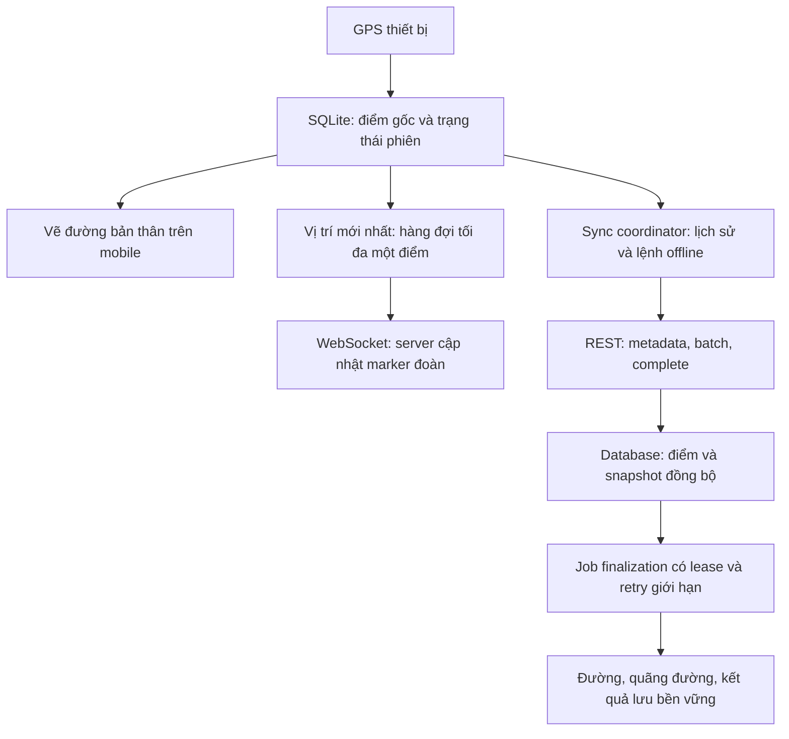

# Trip GPS v2 — Ghi local, vị trí realtime và đồng bộ lịch sử

Ngày: 26/10/2026. Trạng thái: thiết kế đề xuất để triển khai, chưa phải hành vi đã triển khai.

Cập nhật triển khai API: xem [TRIP_GPS_V2_API_HANDOFF.md](./TRIP_GPS_V2_API_HANDOFF.md)
để biết endpoint đang có, hash/revision chính xác và các giới hạn chưa đạt mục tiêu tối ưu của thiết kế này.
Mobile chưa được chuyển đổi trong đợt triển khai API.

Tài liệu này phục vụ đồng thời API tại Vina_TrekGO/api và mobile chính tại
`C:/Users/Admin/Documents/tuHocReactJS/TrekGoMobile`. Thư mục mobile trong repo API không phải mobile chính.
Không sửa code, áp dụng migration hoặc thay policy qua việc tạo tài liệu này.

## 1. Mục tiêu và phạm vi

Yêu cầu đã thống nhất:

- Mọi điểm GPS hợp lệ được lưu bền vững vào SQLite trước khi gửi mạng.
- Chia sẻ vị trí mới nhất qua WebSocket khi có mạng; không phát lại lịch sử vị trí qua socket.
- Chỉ tự đồng bộ lịch sử sau khi người dùng kết thúc phiên: nếu có mạng thì đồng bộ ngay,
  nếu offline thì giữ SQLite và chờ có mạng để đồng bộ phần còn thiếu. Reconnect khi còn ACTIVE/PAUSED không tự upload lịch sử.
- Kết thúc trên điện thoại phải thành công không phụ thuộc mạng: dừng thu GPS, lưu endedAt và trạng thái chờ đồng bộ.
- Không yêu cầu thành viên xem toàn bộ đường người khác đã đi trong thời gian thực.
- Không dựng lại toàn bộ lịch sử đường đi sau mỗi điểm realtime hoặc mỗi batch upload.
- Lỗi mạng, P2028 hoặc lỗi job phải được cô lập vào thao tác tương ứng; dữ liệu local được giữ để tiếp tục.

Chỉ thay đổi trip GPS và phần kết nối cần thiết. Không refactor auth, booking, rental, personal trail hoặc tự thay nghiệp vụ checkpoint.
Tái sử dụng kiểm tra quyền, shared errors, kết nối Prisma, Socket.IO và outbox hiện có.

Không có thiết kế nào bảo đảm tiến trình không bao giờ chết: OOM, lỗi native, máy chủ bị tắt vẫn có thể xảy ra.
Tiêu chí ở đây là lỗi GPS dự kiến không trở thành uncaught exception/unhandled rejection, không tạo retry vô hạn và không chiếm hết tài nguyên dùng chung.

## 2. Hiện trạng đã đọc trong code

API:

- `src/modules/geo/infrastructure/adapters/trip-gps-recording.service.ts`: start, upload, control, reconcile.
- `src/modules/geo/application/gps-track.service.ts`: đọc lịch sử, dựng đường, checkpoint và deviation.
- `src/modules/geo/application/gps-projection.service.ts`: trạng thái đoàn và vị trí.
- `src/modules/geo/infrastructure/workers/gps-track-refresh.worker.ts`: xử lý refresh sau upload.
- `src/modules/geo/presentation/gateways/trip-gps.gateway.ts`: socket và outbox.
- `prisma/schema.prisma`: GpsSession, GpsLocation, TripActualRoute, GpsStartReceipt, GpsOutboxEvent.

Mobile chính:

- `src/features/trip-gps/hooks/useTripGps.ts`.
- `src/features/trip-gps/services/trip-gps.storage.ts`, `trip-gps.api.ts`, `trip-gps.socket.ts`.
- `src/services/location/backgroundLocationTask.ts` hiện ghi luồng recording khác, chưa phải collector của trip GPS.

Các hạn chế hiện tại:

1. Mở màn hình gọi context trước khi khôi phục SQLite; mở lại offline có thể không khôi phục được.
2. Pause/resume/finish gọi mạng trực tiếp; hàm enqueueSessionCommand tồn tại nhưng các nút chưa dùng.
3. Finish chờ upload hết trước khi hoàn tất giao diện.
4. Upload định kỳ một batch/session; backlog cũ có thể làm chậm vị trí hiện tại.
5. Upload tạo job dựng lại lịch sử; realtime và lịch sử chưa tách biệt.
6. Trip GPS dùng foreground watcher gắn với hook; chưa bảo đảm thu GPS khi rời màn hình/khóa máy.
7. Map matching sửa tọa độ trước khi lưu; dữ liệu gửi không luôn là tọa độ gốc.
8. Worker claim job bằng PUBLISHED chưa có lease phục hồi đầy đủ khi process chết giữa chừng.

Log personal trail có P2028 tại createMany và personalTrail.create: transaction không còn hiệu lực.
Chưa có bằng chứng đủ để kết luận timeout hay mất kết nối. Không coi lỗi đó là lỗi của nguyên tắc lưu local + upload batch.

## 3. Kiến trúc đích



Ba nhiệm vụ độc lập: collector local, publisher vị trí và sync coordinator.
Một lỗi socket không được chặn SQLite; một lỗi lịch sử không được chặn publisher; lỗi mạng không được làm phiên local tự chạy lại sau finish.

## 4. Trạng thái và nguyên tắc dữ liệu

### 4.1 Mobile

Tách hai trục trạng thái:

- `recordingStatus`: ACTIVE, PAUSED, STOPPED.
- `syncStatus`: PENDING, SYNCING, WAITING_NETWORK, PROCESSING, SYNCED, NEEDS_ATTENTION.

STOPPED + WAITING_NETWORK là trạng thái bình thường, không phải lỗi kết thúc.
`serverSessionId` và `clientSessionId` là hai định danh khác nhau; không dùng nhầm ID trong API.
Khóa dữ liệu local theo accountId + tripId + clientSessionId để không đồng bộ dữ liệu của tài khoản cũ sau logout.

### 4.2 Server

Giữ GpsSession.status ACTIVE/PAUSED/STOPPED cho vòng đời ghi.
Thêm trạng thái đồng bộ riêng: OPEN, RECEIVING, FINALIZE_PENDING, PROCESSING, COMPLETE, NEEDS_ATTENTION.
STOPPED không có nghĩa server đã nhận hết điểm. COMPLETE không có nghĩa mọi điểm đều được chấp nhận: phải trả rõ số điểm bị từ chối.
Kết quả READY cần kèm revision đã xử lý để biết nó có khớp snapshot client hay không.

### 4.3 Bất biến

- clientSampleId và commandId được tạo một lần, lưu SQLite trước request, giữ nguyên khi retry.
- Không xóa điểm chưa được ACK bền vững; timeout ACK là kết quả chưa biết, không phải chắc chắn chưa ghi.
- Cùng ID, cùng nội dung chuẩn hóa: trả duplicate. Cùng ID, khác nội dung: conflict.
- Điểm lịch sử giữ recordedAt gốc; receivedAt là thời gian server nhận.
- Metadata pause/resume và endedAt phải được server xác nhận trước khi đánh giá điểm của snapshot tương ứng.
- Không ghi lịch sử từ socket vào gps_locations; không dùng vị trí realtime làm bằng chứng duy nhất cho lịch sử.
- Không sửa tọa độ gốc khi map matching. Geometry hiển thị là dữ liệu dẫn xuất.

## 5. Database: giữ được gì, cần bổ sung gì?

### 5.1 Phần giữ nguyên

| Thành phần hiện có | Sử dụng trong v2 |
| --- | --- |
| gps_sessions | Chủ phiên, thiết bị, policy đóng băng, startedAt/endedAt, trạng thái ghi |
| gps_locations | Điểm lịch sử; unique(sessionId, clientSampleId), index(sessionId, recordedAt) đã phù hợp |
| trip_actual_routes | Kết quả tổng hợp theo trip + user |
| gps_start_receipts | Idempotency tạo phiên |
| gps_outbox_events | Thông báo và job bền vững; bổ sung khả năng claim/retry |
| recording_state JSON | Policy, intervals và metadata tương thích cũ |

Về khả năng lưu tọa độ, schema hiện tại đủ. Có thể prototype bằng JSON và chưa đổi schema.
Để triển khai phục hồi job và đồng bộ có kiểm chứng, tài liệu này khuyến nghị migration additive nhỏ, không dựng hệ thống database mới.

### 5.2 Migration API đề xuất

Thêm bảng một-một `gps_session_sync_states`, FK session_id, gồm:

- `session_id` PK; `protocol_version`; `status`.
- `metadata_revision` tăng đơn điệu cho timeline đã xác nhận.
- `accepted_count`, `rejected_count` là số định danh đã xử lý của snapshot, không đếm số lần request.
- `snapshot_revision`, `snapshot_manifest_hash`, `expected_sample_count` cho checkpoint hoặc kết thúc.
- `processed_snapshot_revision`, `last_error_code`, `updated_at`.

Thêm `gps_sync_batches` để lưu receipt ACK khi phản hồi bị mất:

- PK `(session_id, batch_id)`; `payload_hash`; `metadata_revision`; `snapshot_revision`.
- `response_json` chứa accepted/duplicate/rejected IDs; `created_at`.
- Batch receipt được commit cùng insert điểm và cập nhật tiến độ.
- Giới hạn retention receipt theo vòng đời đồng bộ; chỉ dọn sau khi client xác nhận hoặc hết thời hạn được duyệt.

Thêm các cột vào GpsOutboxEvent cho job lịch sử mới:

- `available_at`, `lease_until`, `lease_owner`, `attempt_count` (hoặc chuẩn hóa retryCount hiện có).
- Index phục vụ eventType + status + availableAt và lease hết hạn; kiểm tra execution plan trước khi chọn index cuối.
- Không thay semantics của consumer cũ một cách ngầm định: event type v2 riêng, chỉ consumer v2 quản lý lease.

Live location có thể giữ trong recording_state nếu dùng update có điều kiện và khóa session ngắn.
Không cập nhật đè toàn bộ JSON từ snapshot đã cũ. Tránh lấy TripGpsProjection của cả trip làm nút khóa cho từng ping.
Nếu đo tải cho thấy JSON gây tranh chấp, bổ sung bảng latest-location riêng bằng migration tiếp theo; chưa bắt buộc.

Không sửa migration đã áp dụng, không reset DB. Backfill session cũ thành protocol v1, không tự đánh dấu COMPLETE.
Không thay unique một phiên mở/người nếu chưa chốt nghiệp vụ. Phiên local mới phải chờ đồng bộ đóng phiên cũ trước khi tạo phiên server mới.

### 5.3 Migration SQLite bắt buộc

Dùng migration có version, transaction và giữ dữ liệu cũ. Bổ sung:

- account_id, recording_status, sync_status, local_revision, server_metadata_revision.
- local_started_at, local_ended_at, last_sync_error, next_retry_at, server_session_id nếu hỗ trợ local draft sau này.
- sample local_sequence tăng đơn điệu trong phiên, payload bất biến, trạng thái PENDING/ACCEPTED/REJECTED.
- Command có local_sequence, commandId cố định, payload, trạng thái và lỗi; không xóa lệnh chưa ACK.
- Snapshot/batch outbox lưu ID, hash, revision và danh sách điểm để retry nguyên payload.
- Context/policy/tuyến/checkpoint cache theo tài khoản và trip.

Không dùng INSERT OR REPLACE lên session có FK cascade vì có thể xóa con. Dùng UPSERT cập nhật rõ từng cột.

## 6. Vòng đời mobile

### 6.1 Mở lại app

Đọc SQLite trước, khôi phục phiên, timeline và đường local. Sau đó mới refresh mạng.
Server cũ không được ghi đè phiên local đã STOPPED thành ACTIVE, hoặc xóa các lệnh chưa đồng bộ.
Account đổi phải dừng publisher/collector của account cũ và cô lập hàng đợi.

### 6.2 Bắt đầu

Giai đoạn đầu giữ yêu cầu bắt đầu mới có mạng như hiện tại; sau khi server trả session, lưu SQLite trước khi thu GPS.
Nếu response start bị mất, retry cùng clientSessionId. Không sinh khóa mới mỗi lần nhấn thử lại.
Mở lại offline một phiên đã có phải tiếp tục được.
Bắt đầu phiên hoàn toàn mới khi offline chưa được user yêu cầu rõ: không tự bật; cần thiết kế cached authorization, policy và giới hạn thời gian riêng nếu bổ sung.

### 6.3 Thu điểm và chạy nền

Đưa collector ra khỏi vòng đời màn hình; hook chỉ hiển thị và gửi ý định điều khiển.
Tái sử dụng hạ tầng Expo background location nhưng định tuyến trip session riêng, không ghi vào personal recording.
Chặn hai collector foreground/background tạo cùng mẫu: dùng định danh xác định hoặc cơ chế một producer.
Timestamp và tọa độ gốc được lưu trước mọi thao tác mạng. Nếu SQLite lỗi/đầy, hiển thị rõ không ghi được; không giả vờ đang ghi an toàn.
Thời gian lấy mẫu là cấu hình yêu cầu; hành vi khóa màn hình/phần mềm bị kill phải kiểm tra trên thiết bị thật.

### 6.4 Pause/resume/finish

Trong một SQLite transaction: cập nhật trạng thái và intervals, thêm command với ID cố định, tăng localRevision.
UI phản ánh local ngay sau commit; không đợi API.
Pause đóng interval, resume mở interval mới; finish đóng interval và ghi endedAt một lần.
Pause/resume chỉ lưu local, kể cả online: không gọi metadata tức thời và không xả lệnh khi reconnect giữa phiên.
Đến finish mới gửi toàn bộ timeline chưa ACK, rồi upload lịch sử. Server vẫn ACTIVE khi local PAUSED là bình thường;
khôi phục app ưu tiên trạng thái local có lệnh chưa ACK. Đoàn không thấy PAUSED/RESUMED tức thời, chỉ thấy marker cuối và socket presence.
Phiên cũ đã gửi metadata giữ chế độ cũ đến finish; mobile lưu controlSyncMode theo phiên, không trộn hai cơ chế.
Finish dừng producer, chờ các write đang chạy, commit STOPPED + snapshot kết thúc + outbox; trả UI thành công.
Nếu lưu local thất bại phải báo thất bại; không tuyên bố đã lưu. Network failure sau đó không tự khởi động lại collector.
Không giữ database transaction trong lúc gọi mạng hoặc chờ người dùng.

## 7. Vị trí realtime qua WebSocket

Event mới đề xuất: `gps:location.publish` trong namespace /gps.

```json
{
  "requestId": "uuid",
  "tripId": "uuid",
  "sessionId": "uuid",
  "deviceId": "stable-device-id",
  "sequence": 42,
  "location": {
    "clientSampleId": "uuid",
    "recordedAt": "2026-10-26T08:00:00Z",
    "latitude": 10.7,
    "longitude": 106.7,
    "accuracyM": 8
  }
}
```

- Xác thực token, quyền hiện tại, thiết bị và session; không tin userId do client gửi.
- DTO strict; giới hạn payload; kiểm tra tuổi điểm và clock skew theo policy.
- sequence được lưu bền vững trên máy; server chỉ nhận điểm mới hơn, không làm marker lùi khi request đến đảo thứ tự.
- Server lưu latest-location ngắn gọn, phát gps:member.updated qua cơ chế hiện có; không tạo lịch sử hoặc job dựng đường.
- ACK chỉ sau commit; nếu phát socket thất bại, snapshot REST vẫn khôi phục được trạng thái. Không hứa socket exactly-once.
- Duy trì memberVersion đơn điệu bằng update nguyên tử; snapshot REST và socket phải đọc cùng nguồn mới nhất.
- Hàng đợi publisher tối đa một điểm chưa gửi; ghi đè bằng điểm mới hơn, timeout ACK thì retry điểm mới nhất.
- Điểm đã quá cũ không được phát lại thành vị trí mới. Dùng recordedAt để phân loại độ mới của vị trí, độc lập trạng thái kết nối socket.
- Khi socket reconnect phải subscribe lại, lấy state và phát latest-point; sync lịch sử không phụ thuộc socket.

Phương án gửi thích ứng đã được người dùng đồng ý đưa vào thiết kế (chưa áp dụng code):

- SQLite vẫn ghi mọi điểm GPS hợp lệ theo collector; bộ lọc publish không được làm mất lịch sử local.
- Với mỗi điểm mới, xét publish khi đã cách lần phát gần nhất ít nhất 5 giây và điểm cách tọa độ đã publish ít nhất 5 m.
- Nếu có dịch chuyển nhưng chưa đạt 5 m, publish điểm hợp lệ mới nhất khi đã qua 15 giây từ lần phát trước.
- Đứng yên không phát lại tọa độ giống nhau. Phân biệt dịch chuyển với nhiễu bằng bộ lọc GPS và accuracy;
  ngưỡng 5 m là ngưỡng publish, không đủ để tự kết luận người dùng di chuyển nếu GPS đang nhiễu.
- Mốc 15 giây là điều kiện xét gửi khi có điểm mới hợp lệ và có dịch chuyển, không phải cam kết mạng/GPS luôn có dữ liệu.
- Publish ngay điểm đủ mới sau bắt đầu/reconnect, không đợi chu kỳ 5 giây. Coalesce trigger để không phát trùng.
- Chỉ một publish đang chờ ACK; giữ tối đa một điểm mới nhất để gửi tiếp. Không xếp hàng mọi điểm realtime.
- Rate limit server phải phù hợp các ngưỡng này và có burst nhỏ cho reconnect; không đổi tần suất collector để giảm traffic socket.
- Không có heartbeat tọa độ 30/60 giây riêng. Ping/pong Socket.IO theo dõi kết nối; không sửa recordedAt để giả điểm mới.

Các ngưỡng 5 giây / 5 m / 15 giây là cấu hình publisher, cần công bố trong context/capabilities và kiểm thử thực địa;
không ghi đè sampleIntervalSeconds, syncIntervalSeconds của policy cũ hoặc session policy đóng băng một cách ngầm định.

### 7.1 Hiển thị marker mượt mà trên mobile

- Sau khi nhận điểm mới đúng thứ tự, animate từ marker đang hiển thị đến tọa độ mới trong khoảng 1–2 giây.
- Animation là hiệu ứng hiển thị, không tạo sample, không ghi SQLite và không được dùng tính distance/checkpoint.
- Khi nhận điểm tiếp trong lúc animation chạy, dùng vị trí đang hiển thị làm điểm bắt đầu và chỉ giữ target mới nhất.
- Không ngoại suy vị trí thành viên khi không có điểm mới. Giữ nguyên marker khi offline và hiển thị lần cập nhật cuối.
- Điểm quá cũ, reconnect có khoảng nhảy lớn hoặc đổi session: cập nhật marker trực tiếp thay vì animate xuyên bản đồ.
  Ngưỡng khoảng nhảy lớn cần cấu hình/đo theo speed, thời gian và accuracy, không tự coi là dữ liệu GPS sai để xóa.
- So sánh memberVersion/live sequence trước khi animate; sự kiện phát lại không làm marker lùi.

### 7.2 Payload và người nhận

- Chỉ phát vị trí cho các socket đã subscribe màn hình bản đồ trip; rời màn hình thì unsubscribe.
  Publisher/collector local vẫn có thể tiếp tục độc lập, không dừng phiên khi không có người xem.
- DTO vị trí v2 chỉ mang tripId, userId, sessionId, eventId, version/sequence, tọa độ, accuracy và timestamp cần thiết.
  Không gửi lặp avatar, tên, roster, policy hoặc toàn bộ member state với mỗi tọa độ.
- Thêm event server-to-client `gps:location.updated` cho DTO gọn này; `gps:member.updated` giữ cho thay đổi trạng thái/thông tin.
  Client merge patch theo version, giữ nguyên metadata thành viên; snapshot REST vẫn trả trạng thái đầy đủ để phục hồi.
- Worker coalesce các event vị trí tồn cùng user/trip thành điểm mới nhất; không gộp mất revocation hoặc sự kiện nghiệp vụ.
- Polling có backoff khi rỗng và ngừng polling vị trí khi instance không có người xem; không bỏ xử lý quyền/thu hồi bắt buộc.

Trạng thái kết nối: ONLINE khi có ít nhất một socket GPS đã xác thực và subscribe hợp lệ của thành viên;
OFFLINE khi socket cuối cùng disconnect hoặc hết hạn phát hiện mất kết nối; UNKNOWN trong lúc chưa đối soát được presence.
Dùng ping/pong transport của Socket.IO để phát hiện kết nối chết, không yêu cầu heartbeat tọa độ riêng.
Rút mạng đột ngột không tạo disconnect tức thì trên server: phải chờ ping timeout; cấu hình và đo độ trễ này khi triển khai.
Disconnect chỉ chứng minh mất kết nối realtime với server, không khẳng định điện thoại mất Internet
(app đóng, token hết hạn hoặc server restart cũng gây disconnect).
Tách connectionStatus khỏi locationFreshness: người ONLINE có thể chưa có điểm GPS mới, điểm STALE không tự biến người đó thành OFFLINE.
Giữ nhãn PAUSED/STOPPED riêng với connectionStatus. Client v1 giữ contract cũ; DTO v2 bổ sung hai trường này.
Presence phải đúng khi nhiều socket hoặc nhiều API instance: đếm kết nối theo user/trip và dùng hạ tầng Socket.IO dùng chung nếu đã có;
không dùng một Map chỉ nằm trong một process để kết luận trạng thái toàn cụm. Khi restart cần khôi phục/reconcile và xóa presence hết hạn.
Không dùng socketConnected làm bằng chứng REST hoặc database đang hoạt động.

## 8. REST đồng bộ lịch sử v2

Giữ v1 phục vụ client cũ. Đường dẫn mới đề xuất dưới `/api/v1/geo/trips/:tripId/gps/sessions/:sessionId/sync`;
protocol riêng `trip-gps-sync/2`, không đổi toàn bộ API version.

### 8.1 POST /metadata

Request: requestId, revision, baseMetadataRevision, ordered commands với commandId/action/occurredAt, local status và endedAt nếu đã kết thúc.
Server kiểm tra timeline tăng thời gian, intervals không chồng nhau, quyền và policy; giới hạn số command/request.
Replay cùng commandId trả kết quả cũ; payload khác báo conflict. Revision cũ không ghi đè mới.
Không gọi nguyên API control hiện tại vì API đó có thể tracks.sync sau từng lệnh; handler v2 chỉ lưu timeline ngắn gọn.
Trả metadataRevision, trạng thái server, thời điểm người dùng kết thúc phiên nếu có và uploadDeadline.
Trip COMPLETED không tự cắt timeline phiên cá nhân đang mở.
Version conflict phải trả version hiện tại; mobile reconcile, không tự sửa expectedVersion rồi phát lại hành động mù quáng.

### 8.2 POST /batches

Request: batchId cố định, payloadHash, metadataRevision, snapshotRevision, samples.
Trần mẫu: min(policy.maxBatchSamples, hard cap v2); khởi điểm batch 100–200, body <=256 KiB, đo và điều chỉnh.
Trần request được kiểm tra trước transaction; không nhận mảng 10000 chỉ vì DTO v1 cho phép.
Server từ chối metadataRevision chưa biết để client gửi timeline trước. Lưu batch trong transaction ngắn:

1. Kiểm tra receipt của batch và hash.
2. Khóa session ngắn, kiểm tra thời hạn/quyền/timeline.
3. Tìm các ID đã có bằng một truy vấn; validate batch ngoài transaction nếu không phụ thuộc DB.
4. Bulk insert điểm mới và lưu ACK receipt trong cùng transaction.
5. Trả acceptedSampleIds, duplicateSampleIds, rejectedSamples, progress và serverTime.

Không tính khoảng cách toàn bộ lịch sử, checkpoint hoặc deviation trong transaction upload.
Replay cùng batchId/payload trả ACK receipt cũ. Payload hash phải dựa trên chuẩn hóa số/thứ tự cố định giữa hai nền tảng.
SQLite chỉ cập nhật trạng thái sau ACK; transaction lỗi hoặc ACK mất thì giữ batch để gửi lại.
Rejection vĩnh viễn được giữ mã lỗi; request lỗi hạ tầng không được chuyển mọi điểm thành REJECTED.

### 8.3 POST /complete

Chỉ hỗ trợ hoàn tất snapshot lịch sử khi session đã STOPPED. Batches, manifest pages và complete
đều kiểm tra STOPPED ở API; phiên ACTIVE/PAUSED bị từ chối HTTP 409 GPS_INVALID_SESSION_STATE
với reason FINISH_REQUIRED_BEFORE_HISTORY_SYNC. Mobile phải đồng bộ FINISH qua metadata trước.
Request: completionId cố định, snapshotRevision, metadataRevision, final=true,
expectedSampleCount, ordered batch manifest (batchId/hash/count), manifestHash và endedAt nếu final.
Chia manifest thành trang nếu lớn; không cho body vô hạn. Counts tính cả accepted và rejected có receipt, không chỉ accepted.
Server kiểm chứng mọi batch trong manifest đã commit và tổng ID duy nhất khớp; hash/count đơn lẻ do client khai báo không đủ chứng minh.
Thiếu batch trả danh sách thiếu có phân trang, không đóng COMPLETE. Hoàn tất nhận snapshot và enqueue job phải cùng transaction.
Response 202: snapshotRevision, processingStatus, job reference. Replay completionId không sinh job trùng.
GET /status: metadataRevision, receivedSnapshotRevision, processedSnapshotRevision, missing batches, counts, lỗi có thể retry.

Không nhận snapshot lịch sử cho phiên ACTIVE/PAUSED; trong lúc ghi chỉ lưu SQLite và phát vị trí realtime.
Snapshot final chỉ COMPLETE sau khi worker commit kết quả đúng revision; dữ liệu tới muộn phải dùng revision tiếp theo có kiểm soát.

### 8.4 Danh sách API giữ nguyên, sửa và thêm mới

Quy ước `B = /api/v1/geo/trips/:tripId/gps`, `S = B/sessions/:sessionId`.
Các đường dẫn dưới đây là thiết kế cần triển khai, không khẳng định đã tồn tại trên server.
REST v2 dùng `X-GPS-Protocol: trip-gps-sync/2`; request có session dùng thêm `X-GPS-Device-Id`.
Bearer token bắt buộc. Không gửi userId để tự xác định chủ phiên; server lấy từ identity.
Không có header protocol thì giữ semantics v1. Protocol đã lưu trên session là nguồn kiểm tra cuối;
client không thể đổi một session từ v1 sang v2 chỉ bằng đổi header.

| Method / đường dẫn | Loại thay đổi | Mobile v2 sử dụng |
| --- | --- | --- |
| GET B/context | Mở rộng response theo protocol | Context cache, quyền, policy, capabilities và sync limits |
| POST B/sessions | Mở rộng request có protocolVersion tùy chọn, mặc định 1 | Tạo session mới v2 có mạng, giữ clientSessionId khi retry |
| GET S | Mở rộng response v2 | Đối soát trạng thái server, metadata revision; không ghi đè trạng thái local đang chờ |
| GET B/state | Mở rộng response v2 | connectionStatus tách locationFreshness, vị trí mới nhất không phụ thuộc dựng lịch sử |
| GET B/my-route | Giữ API, tài liệu hóa độ trễ | Chỉ là đường đã xử lý trên server; màn hình bản thân ưu tiên SQLite |
| GET B/actual-routes/me | Mở rộng metadata v2 | Kèm processed revision để biết kết quả đang theo snapshot nào |
| POST B/end-trip | Giữ quyền; đổi xử lý session v2 | Host/leader kết thúc trip, không tự đóng phiên GPS v2 của thành viên |
| POST S/samples | Giữ cho v1; mobile v2 ngừng gọi | V2 dùng sync/batches |
| POST S/pause | Giữ cho v1; mobile v2 ngừng gọi | V2 chỉ lưu local, gom timeline gửi sync/metadata sau finish |
| POST S/resume | Giữ cho v1; mobile v2 ngừng gọi | V2 chỉ lưu local, gom timeline gửi sync/metadata sau finish |
| POST S/finish | Giữ cho v1; mobile v2 ngừng gọi | V2 lưu local, sync metadata/batches/complete sau |
| POST S/sync/metadata | Thêm | Đồng bộ timeline điều khiển |
| POST S/sync/batches | Thêm | Upload lịch sử có batch receipt |
| POST S/sync/manifests/pages | Thêm | Đăng ký manifest phân trang để complete không có body vô hạn |
| POST S/sync/complete | Thêm | Xác nhận nhận đủ snapshot và enqueue xử lý |
| GET S/sync/status | Thêm | Tiến độ, batch còn thiếu, kết quả và lỗi cuối |

Không thêm API “manual sync” riêng: nút Đồng bộ ngay gọi cùng chuỗi API trên.
Không xóa route v1 cho đến khi các session/client cũ đã được xử lý và có kế hoạch ngừng hỗ trợ.
Nếu client gọi route ghi v1 cho session v2, trả 409 protocol conflict có hướng dẫn dùng sync v2;
không chạy song song hai cơ chế ghi.

### 8.5 Request/response cụ thể cho mobile và API

Ví dụ dưới dùng ký hiệu `uuid`, `hash` thay cho giá trị thực; khi gửi phải dùng UUID/hex hash hợp lệ.
Success REST trả object trực tiếp như contract GPS hiện tại, không thêm envelope success riêng.
Lỗi dùng error/meta ở mục 8.7. Timestamps ISO-8601 UTC; mọi revision là integer dương, base revision có thể là 0.

**Tạo phiên: POST B/sessions → 200**

```json
{
  "clientSessionId": "uuid",
  "deviceId": "stable-device-id",
  "protocolVersion": 2
}
```

Response giữ `session`, `policy`; bổ sung `protocolVersion: 2`, `syncState` và limits cho v2.
Context capabilities công bố supportedSyncProtocols, socketPublishSupported, maxBatchSamples,
maxBodyBytes, maxCommandsPerRequest, maxManifestEntriesPerPage, retry policy và publishInterval nếu đã chốt.
Server chưa hỗ trợ v2 phải báo không hỗ trợ; mobile không âm thầm giả v2 trên session v1.

**POST S/sync/metadata → 200**

```json
{
  "requestId": "uuid",
  "revision": 3,
  "baseMetadataRevision": 1,
  "commands": [
    { "commandId": "uuid", "sequence": 2, "action": "PAUSE", "occurredAt": "2026-10-26T08:10:00Z" },
    { "commandId": "uuid", "sequence": 3, "action": "FINISH", "occurredAt": "2026-10-26T08:15:00Z" }
  ],
  "recordingStatus": "STOPPED",
  "endedAt": "2026-10-26T08:15:00Z"
}
```

Response: `sessionId`, `metadataRevision: 3`, `acknowledgedCommandIds`, `recordingStatus: STOPPED`,
`effectiveEndedAt`, `uploadDeadline`, `syncStatus: RECEIVING`, `serverTime`.
STOPPED chỉ đóng thời gian ghi, vẫn cho upload điểm đến endedAt của phiên cá nhân trong hạn.
Nếu command quá giới hạn thì gửi nhiều request liên tiếp theo revision; không bỏ qua command ở giữa.
Lần đầu không có command mới có thể gửi revision 1/base 0 và timeline ACTIVE khớp session đã tạo.

**POST S/sync/batches → 200**

```json
{
  "batchId": "uuid",
  "payloadHash": "sha256-hex",
  "metadataRevision": 3,
  "snapshotRevision": 1,
  "samples": [
    {
      "clientSampleId": "uuid",
      "recordedAt": "2026-10-26T08:05:00Z",
      "latitude": 10.7,
      "longitude": 106.7,
      "accuracyM": 8,
      "altitudeM": null,
      "speedMps": null,
      "headingDeg": null
    }
  ]
}
```

```json
{
  "sessionId": "uuid",
  "batchId": "uuid",
  "snapshotRevision": 1,
  "acceptedSampleIds": ["uuid"],
  "duplicateSampleIds": [],
  "rejectedSamples": [],
  "progress": { "acceptedCount": 1, "rejectedCount": 0 },
  "serverTime": "2026-10-26T08:20:00Z"
}
```

Batch không enqueue route-refresh. Một batch có rejection vẫn trả 200 vì đã xử lý từng điểm;
malformed request hoặc revision conflict trả lỗi toàn request, không giả ACK từng điểm.

**POST S/sync/manifests/pages → 200**

Request: `manifestId` UUID cố định, `snapshotRevision`, `pageIndex` từ 0, `pageCount`, `entries` gồm
`batchId`, `payloadHash`, `sampleCount`; `pageHash`. Response: manifestId, pageIndex, acknowledged, serverTime.
Manifest bất biến sau khi complete; replay page cùng hash thành công, khác hash trả 409.
Lưu manifest theo snapshot trong sync state JSON có giới hạn hoặc bảng receipt con; nếu dùng bảng con phải thêm vào migration mục 5.
Không để nhiều page tăng JSON không giới hạn: công bố hard cap số batch/snapshot, vượt cap thì chia snapshot.

**POST S/sync/complete → 202, replay đã xong → 200**

```json
{
  "completionId": "uuid",
  "snapshotRevision": 1,
  "metadataRevision": 3,
  "snapshotMaxSequence": 720,
  "final": true,
  "expectedSampleCount": 720,
  "manifestId": "uuid",
  "manifestHash": "sha256-hex",
  "endedAt": "2026-10-26T08:15:00Z"
}
```

Response: sessionId, snapshotRevision, `syncStatus: FINALIZE_PENDING`, processedSnapshotRevision,
statusUrl trỏ GET S/sync/status, serverTime. Không trả COMPLETE trước khi worker commit kết quả.
final bắt buộc true, endedAt bắt buộc và phải khớp session đã kết thúc. final=false bị từ chối HTTP 400 ở DTO.
Server kiểm tra sequence và counts theo manifest đã nhận; snapshotMaxSequence chỉ mô tả ranh giới local,
không tự chứng minh đủ điểm nếu server chưa nhận mapping/manifest. Client phải giữ snapshot membership bất biến.

**GET S/sync/status?snapshotRevision=1&cursor=...&limit=100 → 200**

Response gồm sessionId, metadataRevision, receivedSnapshotRevision, processedSnapshotRevision,
syncStatus, acceptedCount, rejectedCount, missingBatchIds, nextCursor, resultStatus,
actualRouteId (nullable), lastError (code/retryable/nextRetryAt nullable), serverTime.
actualRouteId có thể null khi kết quả chưa được worker xử lý; chỉ dựa processed revision để xác nhận snapshot đã xử lý.
Không trả toàn bộ samples trong status. Khi NEEDS_ATTENTION do worker, manual sync chỉ yêu cầu xử lý lại snapshot
đã nhận qua complete với completionId mới và cùng manifest; server kiểm tra snapshot chưa bị supersede,
reset ngân sách job trong giới hạn rate limit và audit. Không upload lại các batch đã ACK.

### 8.6 Socket: event và ACK cần bổ sung

| Event | Chiều | Thay đổi |
| --- | --- | --- |
| gps:subscribe / gps:unsubscribe | Mobile → API | Giữ; subscribe khai báo protocolVersion 2 để server chọn DTO phù hợp |
| gps:location.publish | Mobile → API | Thêm payload mục 7; chỉ lưu marker mới nhất |
| gps:member.updated | API → mobile | Giữ event; v2 thêm connectionStatus, locationFreshness và live sequence |
| gps:location.updated | API → mobile | Thêm DTO vị trí gọn, phục vụ animation marker; không gửi toàn bộ member mỗi điểm |
| gps:presence.updated | API → mobile | Thêm khi user ONLINE/OFFLINE/UNKNOWN, kèm presenceVersion đơn điệu |
| gps:trip.changed / gps:access.revoked | API → mobile | Giữ quyền và ý nghĩa |
| gps:route.ready / gps:route.failed | API → mobile | V2 thêm sessionId/snapshotRevision để không nhận kết quả cũ |

ACK publish thành công: `{ ok: true, data: { sessionId, sequence, applied, memberVersion, serverTime } }`.
Điểm cũ đến muộn trả applied=false, không làm marker lùi. ACK lỗi: `{ ok: false, error: {...}, meta: {...} }`.
REST state v2 cũng trả presenceVersion để snapshot cũ không ghi đè presence event mới.
Không bắt buộc socket phải còn kết nối mới cho phép upload REST.

### 8.7 Lỗi và retry theo endpoint

| HTTP | Trường hợp | Mobile |
| --- | --- | --- |
| 400 | DTO sai, vượt batch/command limits | Dừng tự retry, hiển thị lỗi và giữ local |
| 401 | Token hết hạn | Refresh tối đa một lần; không refresh lặp vô hạn |
| 403 | Không còn quyền/thiết bị không được phép | Dừng, không xóa local |
| 409 | Version/protocol/ID conflict hoặc manifest thiếu | Đọc details/status; reconcile hoặc gửi batch thiếu, không retry mù |
| 413 | Body quá lớn | Chia batch/manifest mới đúng giới hạn; không thay payload của ID cũ |
| 429 | Quá tải/rate limit | Theo Retry-After và ngân sách retry |
| 503 | DB tạm mất kết nối, transaction mất hiệu lực, queue đầy | Giữ local, retry cùng ID theo ngân sách |

Mã lỗi GPS cụ thể phải rà soát và bổ sung shared registry trước khi code. Không dùng mã chưa đăng ký.
Ví dụ envelope lỗi hạ tầng (dùng mã GPS_TEMPORARILY_UNAVAILABLE nếu registry hiện tại phù hợp):

```json
{
  "error": {
    "code": "GPS_TEMPORARILY_UNAVAILABLE",
    "message": "GPS temporarily unavailable",
    "details": { "operation": "SYNC_BATCH", "retryAfterSeconds": 5 },
    "retryable": true
  },
  "meta": {
    "requestId": "uuid",
    "serverTime": "2026-10-26T08:20:00Z",
    "contractVersion": "0.2.0-final-flow"
  }
}
```

Không trả SQL, stack trace hoặc Prisma connection string cho client. RequestId phục vụ đối chiếu log server.

### 8.8 Chuỗi gọi từ mobile theo thao tác

| Thao tác | Local trước | Mạng sau |
| --- | --- | --- |
| Mở GPS | Đọc cache và phiên SQLite | context → session → state khi mạng dùng được |
| Bắt đầu có mạng | Lưu clientSessionId trước request | POST sessions → lưu session → subscribe/publish |
| Nhận điểm GPS | Commit SQLite, vẽ local | Publish thích ứng 5 giây / 5 m; tối đa 15 giây khi có dịch chuyển và điểm hợp lệ mới |
| Pause/resume | Commit status + command | Không gọi API; giữ lệnh đến finish |
| Finish | Dừng collector, commit STOPPED + command + snapshot | metadata → batches → manifest pages → complete → status |
| Mạng trở lại, phiên còn ACTIVE/PAUSED | Giữ lịch sử SQLite | ACTIVE phát latest-point; không tự upload lịch sử |
| Mạng trở lại, phiên đã STOPPED còn pending | Chụp snapshot phần chưa đồng bộ | Chạy chuỗi sync lịch sử từ checkpoint đã ACK |
| Bấm Đồng bộ ngay | Dùng lại outbox/checkpoint | Cùng chuỗi sync; không API đặc biệt hoặc uploader thứ hai |

## 9. Sync coordinator và thứ tự offline

Coordinator chạy độc lập màn hình. Local finish lưu STOPPED trước, sau đó có mạng thì kích hoạt đồng bộ ngay.
Trigger mở app hoặc mạng trở lại chỉ tự đồng bộ các phiên đã STOPPED còn dữ liệu chờ; không tự đồng bộ phiên ACTIVE/PAUSED.
Nút Đồng bộ ngay phục vụ phiên đã kết thúc còn chờ hoặc lỗi đồng bộ.
API cũng chặn upload lịch sử của phiên ACTIVE/PAUSED; không còn nhánh checkpoint giữa phiên.
Mỗi thiết bị một uploader lịch sử đang chạy; mỗi session một lượt đồng bộ. Coalesce trigger trùng.

```text
Đọc SQLite theo account
→ refresh auth nếu cần
→ xác nhận session server
→ gửi timeline chưa ACK theo thứ tự
→ chụp snapshot có giới hạn sequence
→ upload các batch chưa ACK
→ complete(snapshot)
→ theo dõi status có backoff
→ lưu processed revision
→ dọn dữ liệu đủ điều kiện
```

Khi reconnect trong phiên ACTIVE: chỉ gửi vị trí mới nhất qua socket, không đồng bộ backlog lịch sử.
Trong phiên PAUSED không phát điểm mới; lịch sử tiếp tục ở local. Không có timer tự upload lịch sử trong lúc ghi.
Phiên STOPPED có backlog mới được tự đồng bộ khi mạng dùng được. Không tự chuyển ACTIVE thành STOPPED để kích hoạt sync.
Realtime publisher vẫn hoạt động độc lập trong lúc backlog đang gửi.
Nút “Đồng bộ ngay” luôn có cho phiên còn dữ liệu chờ; hiển thị số điểm/batch còn lại, trạng thái và lỗi cuối.
Nếu đang đồng bộ thì nút chỉ mở tiến độ, không tạo uploader thứ hai. Khi offline vẫn giữ yêu cầu và báo chờ mạng, không báo thành công.

Ngân sách đề xuất cụ thể: mỗi đợt đồng bộ có một lần chạy đầu và tối đa 3 lần tự thử lại khi lỗi tạm thời,
tức tối đa 4 lần chạy. Chờ 5, 15, 30 giây trước các lần thử lại, kèm jitter; nếu Retry-After dài hơn thì tuân theo server.
Đây là retry đợt sync từ checkpoint đã ACK, không upload lại từ đầu và không giới hạn tổng số batch của lịch sử.
Mỗi request lỗi chấm dứt lượt hiện tại; không thêm một tầng retry HTTP tự động khác khiến số lần bị nhân lên.
Khi mạng mất rõ ràng, dừng timer retry và chuyển WAITING_NETWORK; không đốt ba lượt bằng request khi đang offline.
Hết 3 retry chuyển NEEDS_ATTENTION, giữ SQLite, báo “Chưa đồng bộ xong — nhấn Đồng bộ lại”.
Lỗi 400/403/409/UPLOAD_CLOSED không retry tự động; 401 chỉ refresh auth một lần rồi dừng nếu không thành công.
Polling status PROCESSING không tính là retry upload, nhưng phải có backoff và hạn theo dõi; hết hạn hiển thị chờ xử lý, không tạo lại complete/job.

Mỗi lần chuyển offline sang online ổn định tạo tối đa một đợt tự đồng bộ; debounce 5 giây và cooldown 60 giây
để mạng chập chờn không liên tục reset ngân sách. Không tự bắt đầu lại khi mạng vẫn online sau khi đã hết lượt.
Manual sync có thể mở đợt mới có cùng ngân sách, giữ nguyên ID batch/command và checkpoint.
Server không retry inline P2028; transaction retry nội bộ tối đa một lần chỉ cho deadlock/serialization đã xác nhận rollback.
Job finalization có ngân sách riêng: lần đầu + tối đa 3 retry có delay, sau đó NEEDS_ATTENTION; status phải cho biết lỗi job,
không bắt mobile upload lại điểm đã có. Các con số retry này là đề xuất kỹ thuật để duyệt, chưa phải hành vi code hiện tại.
Không retry vô hạn bằng vòng while nóng, không tạo một request cho mỗi điểm cũ.

## 10. Kết thúc trip, quyền và thời hạn

Local finish của cá nhân không tự hoàn tất trip của cả đoàn. Giữ end-trip cho host/leader.
Theo yêu cầu đã chốt: trip COMPLETED và session GPS cá nhân có vòng đời độc lập.
Leader kết thúc trip không tự đóng session ACTIVE/PAUSED của thành viên, dù online hay offline.
Thành viên có thể tiếp tục ghi, pause/resume và tự finish phiên đã mở; mọi điểm hợp lệ sau trip.completedAt
vẫn thuộc lịch sử cá nhân trong trip và được tính vào đường đi/quãng đường của người đó.
Không cắt dữ liệu theo trip.completedAt hoặc ép endedAt cá nhân bằng thời điểm leader kết thúc.
Mobile nhận trip.changed chỉ cập nhật thông báo trạng thái trip; không dừng collector, không tự enqueue FINISH.
Có thể hiển thị “Chuyến đi đã kết thúc; bạn vẫn đang ghi GPS” với nút tự kết thúc, không tự xác nhận thay người dùng.
Leader muốn dừng GPS của chính mình cũng thực hiện finish cá nhân riêng; end-trip không có tác dụng phụ ngầm lên session đó.

Server giữ riêng trip.completedAt và session.endedAt. Hạn upload của session tính từ endedAt cá nhân,
không bắt đầu đếm từ lúc leader kết thúc khi session vẫn đang mở.
Việc tiếp tục phiên có sẵn sau COMPLETED được phép; tạo session mới sau COMPLETED vẫn bị chặn ở phạm vi hiện tại.
Quyền GPS phải còn hợp lệ; không đánh đồng trip COMPLETED với membership bị thu hồi.
Cancellation/access revocation tiếp tục là ngoại lệ theo chính sách hiện có, không cấp quyền ghi thêm sau khi bị thu hồi.

Các vị trí API phải sửa rõ cho protocol v2:

- `closeForTrip`/`reconcile`: không auto-close do COMPLETED; không để periodic reconciliation đóng lại phiên cá nhân.
- `endTrip`: không gọi nhánh đóng mọi session v2; phiên v1 giữ contract cũ trong giai đoạn chuyển đổi.
- `control` và sync metadata/batches: cho phép tiếp tục phiên có sẵn khi trip COMPLETED.
- `context.permissions.canRecord`: tách canStartNewSession và canContinueExistingSession;
  mobile không dùng điều kiện trip chưa kết thúc để tắt collector đang chạy.
- Projection: không trả locationStatus STOPPED chỉ vì trip.status khác IN_PROGRESS;
  trạng thái ghi dựa session, connectionStatus dựa socket, freshness dựa recordedAt.
- `GpsTrackService`: tiếp tục nhận điểm sau trip.completedAt, không phát kết quả cá nhân cuối trước khi các session của người đó STOPPED.
- Màn hình đoàn vẫn có thể xem vị trí người đang ghi sau COMPLETED nếu còn quyền;
  không tự unsubscribe hoặc ngừng worker fanout chỉ vì trip đã hoàn tất.

Không tự đổi local endedAt thành thời gian nhận request. Session chưa được user finish không bị TTL sync tự kết thúc;
app có thể nhắc phiên đang ghi lâu nhưng không tự đóng. Giới hạn thời lượng nếu bổ sung sau cần quy định riêng.
Giữ chính sách hiện tại cho CANCELLED/ACCESS_REVOKED: không nới quyền nhận dữ liệu vì client còn SQLite.
Giữ lateSyncGraceSeconds hiện tại đến khi được duyệt đổi. Policy vừa kiểm tra là 86400 giây từ endedAt, không phải từ lúc reconnect.

Hệ quả quan trọng: offline lâu hơn hạn có thể không tự đồng bộ được; giữ dữ liệu local và hiển thị UPLOAD_CLOSED, không xóa.
Muốn bảo đảm đồng bộ sau nhiều ngày phải duyệt tăng hạn hoặc cơ chế mở lại có audit. Không tự bỏ giới hạn quyền/thời gian.

## 11. Checkpoint và lệch tuyến

Tách vị trí realtime khỏi lịch sử làm thay đổi thời điểm đánh giá nghiệp vụ; không âm thầm thay thế thuật toán hiện tại.

Đề xuất giai đoạn đầu:

- Kết quả checkpoint/deviation chính thức được tính từ lịch sử đã đồng bộ.
- Hiển thị rõ thời điểm cập nhật, không trình bày kết quả cũ là cảnh báo hiện tại.
- Nếu cần cảnh báo offline tức thời, mobile tính từ GPS gốc và cached route dưới nhãn local; chưa tự ghi checkpoint chính thức.
- Nếu cần server cảnh báo theo live point, thiết kế pipeline tăng dần riêng; chu kỳ publish được chọn có thể khác chu kỳ collector.
- Không dùng realtime sparse points để tái tạo toàn bộ lịch sử hoặc tự thay tiêu chí consecutive samples.

Phải chốt phương án này trước rollout cho người dùng đang phụ thuộc cảnh báo an toàn/checkpoint realtime.

## 12. Ngăn lỗi GPS làm gián đoạn server

### 12.1 Transaction và kết nối

- Reuse PrismaService; không tạo pool mới mỗi request/job hoặc disconnect pool dùng chung khi request lỗi.
- Transaction chỉ chứa đọc/ghi liên quan nguyên tử; không gọi HTTP/DEM, socket ACK hoặc chạy toàn bộ hình học trong đó.
- Ngân sách khởi điểm để benchmark: lock_timeout 2 giây, statement_timeout 5 giây, transaction timeout 10 giây, maxWait 2 giây.
- SET LOCAL trong transaction; không SET session-wide trên pool khiến request khác bị ảnh hưởng.
- Timeout là giới hạn toàn transaction, không phải giấy phép giữ khóa 10 giây; chốt giá trị theo đo thực tế.
- Pool có giới hạn connection/queue và thời gian chờ; giữ đủ tài nguyên cho API khác. Đo trước khi đổi PrismaService chung.
- P2028: kết thúc lần thử, không tiếp tục dùng tx cũ, trả lỗi tạm thời. Client replay request idempotent.
- P2034/deadlock: chỉ retry toàn transaction idempotent tối đa 1–2 lần với jitter; không retry một câu create trong tx đã hỏng.
- Commit không rõ kết quả: tra receipt hoặc replay cùng ID, không sinh ID mới.

### 12.2 Worker không chặn request

- Complete chỉ enqueue; worker claim bằng thao tác nguyên tử, lease và availableAt.
- Worker chết sau claim: lease hết hạn thì instance khác nhận lại. Persist retryCount, delay và lỗi đã làm sạch.
- Retry có trần; hết trần chuyển NEEDS_ATTENTION, không quét lại liên tục mỗi 250 ms.
- Đọc dữ liệu có trang/giới hạn; tính geometry ngoài transaction và ngoài event loop chính khi dữ liệu lớn, bằng worker thread/process phù hợp.
- Đặt trần số điểm/job và bộ nhớ; chia job hoặc giản lược có kiểm chứng cho hành trình lớn, không bỏ điểm gốc âm thầm.
- Khi commit kết quả phải kiểm tra snapshot revision còn đúng; stale job không ghi đè revision mới.
- Side effects checkpoint phải idempotent; không giữ transaction dài để xử lý mọi điểm. Thiết kế commit theo chunk có cursor nếu cần.
- Giới hạn concurrency ban đầu 1 job nặng/instance và tải toàn cụm; không mỗi socket khởi tạo một worker.

### 12.3 HTTP, socket và tác vụ nền

- Mọi promise từ timer/socket/background task phải await/catch; timer không được chồng lượt xử lý.
- Shared GlobalErrorFilter định dạng HTTP; không thêm controller filter riêng.
- Reuse ZodValidationPipe; AppError code phải đăng ký status/message/retryable trong ERROR_DEFINITIONS và export barrel.
- Socket dùng ACK có error/meta tương đương formatter hiện có; không đưa HTTP-only GlobalErrorFilter trực tiếp vào gateway.
- Mã tạm thời: 503 retryable; quá tải: 429 và Retry-After; conflict: 409; validation: 400; auth: 401/403.
- Kiểm tra mapping hiện tại trước khi thêm code mới; không coi mọi 500 là an toàn để retry.
- Payload/body, socket frequency, số upload song song và backlog worker đều có giới hạn.
- Không dùng process.on('uncaughtException') để nuốt lỗi rồi tiếp tục chạy process không rõ trạng thái.
- Supervisor restart và graceful shutdown là lớp phục hồi cuối: stop accepting jobs, kết thúc trong hạn, lease phục hồi; chưa ACK khi chưa commit.

### 12.4 Quan sát và tiêu chí vận hành

Log có requestId, tripId/sessionId, protocol, batchId, revision, durationMs, error code, retry attempt; không log token, DATABASE_URL hoặc toàn bộ tọa độ.
Theo dõi p95/p99 upload/live ACK, transaction timeout, lock wait, pool wait, event-loop lag, RSS/heap, pending jobs, oldest job age và lease recovery.
Readiness có thể báo phụ thuộc DB không sẵn sàng; liveness không restart process chỉ vì DB mất mạng tạm thời.
GPS overload phải trả 429/503 nhanh; kiểm tra API khác vẫn phục vụ dưới tải GPS được giới hạn.

### 12.5 Worker phát socket qua database dùng chung

Bối cảnh triển khai/test: nhiều API local kết nối cùng database đã deploy; mỗi mobile có thể nối tới một API khác nhau.
Chỉ emit tại API nhận vị trí không chuyển sự kiện sang các API còn lại nếu chưa có Redis adapter.
Phương án trong thiết kế này là tiếp tục dùng database outbox để fanout; Redis không phải điều kiện bắt buộc.

Hiện trạng đã kiểm tra trong code và database cấu hình:

- Có bảng `gps_outbox_events`, chưa có bảng consumer/cursor GPS riêng từng instance.
- Gateway polling mỗi 100 ms, lấy PENDING hoặc sự kiện mới tạo/publish trong 15 giây.
- Mỗi process có Map `seen` riêng. API A đánh dấu PUBLISHED không lập tức ngăn B đọc nhờ cửa sổ 15 giây.
- Đây là cơ chế cửa sổ có phục hồi snapshot, không phải xác nhận bền vững mọi API đã nhận sự kiện.
- Gateway hiện gọi `recording.authorize()` theo từng sự kiện/từng socket, tạo nhiều truy vấn và có thể đi qua transaction nặng.

Luồng đích:

```text
Mobile A publish vị trí
→ API A cập nhật latest-location + ghi outbox trong cùng transaction ngắn
→ Worker từng API đọc sự kiện chưa nhận của chính instance đó
→ Kiểm tra quyền người nhận theo batch
→ Mỗi API emit cho socket local hợp lệ
→ Lưu tiến độ nhận riêng của instance
```

Không dùng status PUBLISHED/PROCESSED chung làm điều kiện loại sự kiện khỏi mọi consumer realtime.
Phân biệt fanout event (mọi instance liên quan cần đọc) và job lịch sử (một worker claim thực thi).
Không áp dụng lease claim một người xử lý của job lịch sử cho sự kiện phát nhiều instance.

Migration bổ sung cho phương án DB fanout:

- `gps_event_consumers`: instance_id, lease/last_seen_at, trạng thái và dữ liệu tiến độ.
- Tiến độ phải được thiết kế chống commit đảo thứ tự; không chỉ dùng UUID, createdAt hoặc BIGSERIAL high-water mark.
  Sequence cấp trước commit không bảo đảm transaction có sequence nhỏ đã commit khi consumer tiến lên.
- Phương án triển khai đầu tiên: thêm `gps_event_deliveries` với PK `(event_id, instance_id)`, trạng thái/attempt và thời điểm xử lý.
  Consumer truy vấn sự kiện còn trong retention, thuộc trip local đang có subscription, chưa có receipt của nó;
  receipt được ghi sau lượt xử lý. Query theo ID receipt tránh bỏ sót transaction commit muộn.
- Emit rồi process chết trước receipt có thể phát trùng; client deduplicate eventId và so sánh memberVersion/presenceVersion.
  Không cam kết exactly-once. Receipt chỉ chứng minh server đã xử lý phát, không chứng minh điện thoại đã nhận.
- Instance không có người xem GPS thì ngừng quét sự kiện vị trí; subscription mới luôn lấy snapshot state trước.
- Consumer bị ngừng lâu hoặc sự kiện quá hạn thì khôi phục bằng snapshot, không phát backlog marker cũ.
- Gộp sự kiện vị trí cùng user/trip trong một lượt đọc, chỉ phát bản mới nhất; đánh dấu các sự kiện bị gộp đã xử lý cho instance đó.
  Không gộp bỏ sự kiện thu hồi quyền hoặc các sự kiện nghiệp vụ khác như route-ready.
- Có TTL consumer, retention event/receipt và hard cap batch. Consumer đã chết không giữ outbox vô hạn.
- Polling có backoff khi rỗng, không cố định 100 ms trên mọi instance. Chu kỳ tối thiểu/tối đa chốt bằng đo độ trễ và tải;
  không tự lấy chu kỳ publish GPS làm chu kỳ polling. Query phải có index và đo execution plan.

Bảng deliveries tăng số write theo event × instance, nên đây là đánh đổi để có tiến độ rõ ràng, không phải giảm network tuyệt đối.
Đo so với cơ chế cửa sổ hiện tại; nếu fanout tăng lớn, ưu tiên Redis adapter/broker dùng chung thay vì tăng polling hoặc receipt vô hạn.
Các bảng consumer/deliveries là phần thêm vào migration mục 5 nếu chọn triển khai phương án này.

### 12.6 Kiểm tra quyền theo batch trước khi phát sự kiện

Phương án triển khai ưu tiên: bỏ lời gọi authorize đầy đủ cho mỗi sự kiện × mỗi socket;
kiểm tra quyền theo batch trong mỗi lượt worker và dùng chung kết quả cho các socket cùng user/trip.
Không giảm kiểm tra quyền bằng cách cho mọi socket vào room hoặc chỉ tin quyền client gửi.

1. Khi connect: xác thực token, account ACTIVE và thời hạn token như hiện tại.
2. Khi subscribe: kiểm tra quyền đầy đủ bằng GpsAccessService, chỉ join room sau khi thành công.
3. Mỗi lượt worker: lấy các event có giới hạn, xác định người nhận local, deduplicate `(userId, tripId)`.
4. Đọc account/membership/participant/assigned-leader theo các truy vấn bulk có giới hạn kích thước.
   Tái sử dụng chính xác quy tắc GpsAccessService cho trip PUBLIC/PRIVATE; không tạo bộ quy tắc quyền khác trong gateway.
5. Dùng một map kết quả quyền cho cả lượt phát; nhiều event hoặc nhiều socket cùng người/trip không truy vấn lại.
6. Trước emit kiểm tra nhanh token còn hạn, socket còn subscribe và kết quả batch cho phép.
   Người mất quyền bị leave room và nhận access.revoked; không phát event vị trí cho người đó.

Tách authorization read-only khỏi `recording.authorize()` nếu hàm đó đang chạy transaction/refresh projection.
Kiểm tra quyền người nhận không được kích hoạt dựng lịch sử, reconcile nặng hoặc khóa trip theo mỗi người nhận.
Giới hạn số cặp mỗi batch; một instance chỉ một lượt kiểm tra đang chạy, không chồng timer.
Event gửi riêng recipientUserId cũng phải kiểm tra người nhận tương ứng, không bỏ qua quyền vì không qua room broadcast.

Thu hồi quyền:

- Khi nghiệp vụ xóa thành viên/thu hồi quyền thành công, ghi revocation event trong cùng transaction qua outbox dùng chung.
- Mỗi instance xử lý revocation trước các event vị trí của lượt đọc; invalidate dữ liệu quyền đã đọc nếu có liên quan,
  leave room, thông báo và chặn phát tiếp. Không dùng receipt của instance khác để bỏ qua revocation.
- Việc bổ sung event ở module sở hữu membership phải phối hợp qua điểm tích hợp hiện có, không tự sửa auth/booking ngoài phạm vi.
- Account bị khóa hoặc token hết hạn cũng phải dừng quyền nhận. Không để cached subscribe tồn tại vô hạn.
- DB/bulk authorization lỗi: không phát dữ liệu được bảo vệ dựa trên trạng thái cũ không được xác nhận;
  defer event, backoff có giới hạn và log tổng hợp. Local recording vẫn tiếp tục.

Giới hạn nhất quán: quyền có thể thay đổi sau truy vấn batch và trước emit; batch authorization không bảo đảm thu hồi tức thời tuyệt đối.
Ưu tiên lượt phát ngắn, revocation event nhanh và kiểm tra lại ở lượt tiếp theo. Nếu nghiệp vụ cần bảo đảm mạnh hơn,
phải thiết kế ACL version/serialization riêng; không giữ transaction DB mở trong khi emit socket.

Cache TTL qua nhiều lượt là tối ưu giai đoạn sau, chưa bật mặc định. Chỉ áp dụng khi có invalidation,
hạn freshness, đồng bộ đa instance và benchmark; cache hết hạn hoặc instance không theo kịp revocation thì phải xác minh lại trước phát.
Periodic revalidation hiện tại cần gom theo các cặp user/trip thay vì một query/account và authorize cho từng socket.

Kiểm thử bổ sung bắt buộc:

- Hai API cùng đọc một event: cả hai phát cho socket local; receipt A không chặn B.
- Transaction event commit muộn không bị cursor bỏ qua; instance restart không làm marker lùi.
- Một user có nhiều socket và nhiều event chỉ tạo số truy vấn bulk theo batch, không theo tích event × socket.
- Thu hồi quyền giữa các lượt: lượt sau không phát; revocation ưu tiên hơn vị trí trong cùng lượt.
- DB authorization lỗi: không rò dữ liệu; không retry nóng hoặc làm crash worker.
- Receipt sau emit bị lỗi: phát lại không làm client rollback version; TTL cleanup không xóa event còn trong phạm vi cam kết.

## 13. Dọn dữ liệu

Không xóa vì socket ACK, batch ACK đơn lẻ hoặc finish local.
Chỉ dọn điểm của snapshot khi: server đã xử lý đúng revision, mọi batch được đối soát, command đã ACK và không có snapshot mới phụ thuộc.
Điểm bị reject giữ báo cáo và lựa chọn xử lý; không che lỗi bằng cách tính chúng là cung đường đầy đủ.
Giữ bản local sau sync một khoảng có cấu hình để đối chiếu; hạn giữ cần được duyệt. Điểm pending không tự hết hạn do cleanup.
Retention server không purge raw của phiên còn sync chưa hoàn tất mà không có quy tắc rõ ràng; không để outbox/receipt tăng vô hạn.

## 14. Thứ tự triển khai

1. Chốt các quyết định ở mục 16; cập nhật contract/OpenAPI và kiểu dùng chung.
2. Migration additive + v2 metadata/batch/complete/status; giữ nguyên v1 và client cũ.
3. Worker lease/retry/revision; thêm fault injection và quan sát trước khi tăng tải.
4. Socket publisher vị trí độc lập + snapshot REST đọc cùng nguồn; ngăn marker lùi.
5. SQLite migration và coordinator mobile; collector nền; chuyển các nút điều khiển sang local-first.
6. Mỗi session lưu protocol cố định: session v1 hoàn thành theo v1, session mới v2; không trộn hai uploader cùng phiên.
7. Feature flag theo client/session, rollout nhỏ, so sánh counts/distance và tài nguyên rồi mở rộng.
8. Rollback tắt tạo session v2 mới nhưng tiếp tục nhận đồng bộ phiên v2 đã tạo. Không xóa bảng/cột và không ép payload v2 qua v1.

Phần mobile nằm ngoài workspace ghi hiện tại; khi thực thi cần quyền ghi phù hợp. Tài liệu không thay thế quyền hệ thống đó.

### 14.1 Chia phase và đầu việc API / mobile

Các phase dưới là kế hoạch thực thi, chưa đánh dấu đã hoàn thành. Có thể phát triển mobile bằng mock contract
trong lúc API thực hiện, nhưng chỉ tích hợp khi contract tương ứng đã được kiểm tra. Không bật v2 cho người dùng thật từng phần.

| Phase | Đầu việc API | Đầu việc mobile chính | Điều kiện hoàn thành |
| --- | --- | --- | --- |
| 0 — Chốt contract | Chốt DTO, error codes, capabilities, hash chuẩn hóa, trạng thái và revision; cập nhật OpenAPI/socket contract; chốt checkpoint/deviation và policy còn mở | Đối chiếu DTO/types, màn hình trạng thái, migration SQLite, quyền background và account isolation | Hai bên dùng cùng ví dụ request/ACK, quy tắc revision/retry; các quyết định ảnh hưởng nghiệp vụ đã rõ |
| 1 — Nền tảng lưu bền vững | Migration additive cho sync states, batch receipts, manifest storage, outbox lease và consumer/delivery; giữ v1 | Migration SQLite có version; lưu điểm gốc, timeline/commands, snapshot và batch IDs bất biến; cache context | Dữ liệu cũ còn nguyên; restart không mất pending; migration có thể chạy lại an toàn |
| 2 — Ghi và điều khiển local | Start session v2 idempotent; context canStart/canContinue; COMPLETED không đóng phiên v2; metadata endpoint | Collector độc lập màn hình, background trip riêng; pause/resume/finish commit local trước; khôi phục offline; không map-match dữ liệu gốc | Finish offline và restart vẫn STOPPED; leader kết thúc không dừng người khác; v1 không đổi hành vi |
| 3 — Đồng bộ lịch sử | Batches, manifest pages, complete/status; idempotency receipts; transaction ngắn; worker finalization có lease/revision/retry | Sync coordinator độc lập socket/màn hình; reconnect/finish/manual; snapshot và checkpoint; retry 1+3; UI tiến độ/lỗi | Mất ACK hoặc DB lỗi không tạo trùng/mất điểm; worker chết có phục hồi; COMPLETE đúng revision |
| 4 — Realtime nhiều API | location.publish và DTO location.updated; latest-location; DB fanout từng instance; bulk authorization; presence và state phục hồi | Publisher thích ứng 5 giây/5 m/15 giây; một pending point; subscribe/unsubscribe; merge version và animate marker; giữ marker offline | Hai mobile nối hai API local vẫn thấy vị trí; receipt A không chặn B; không query quyền theo event × socket |
| 5 — Nghiệp vụ và chống lỗi | Hoàn thiện checkpoint/deviation theo phương án đã chốt; giới hạn payload/pool/job; shared errors HTTP/socket; retention có điều kiện | Thông báo kết quả local/server, rejection, hết hạn, quyền bị thu hồi, storage đầy; cleanup an toàn và thao tác Đồng bộ lại | Chạy các failure case mục 15; không xóa pending; không uncaught exception/retry nóng; không rò dữ liệu |
| 6 — Tích hợp và rollout | Load test có giới hạn, metrics, feature flags, chạy đồng thời v1/v2; runbook rollback | Kiểm tra máy thật foreground/background, mạng yếu, kill/reopen, hai tài khoản/thiết bị; bật v2 theo flag cho phiên mới | Có số liệu tải/độ trễ, test report, danh sách giới hạn còn lại; rollback vẫn nhận sync phiên v2 đã tạo |

### 14.2 Thứ tự phụ thuộc và phạm vi sửa

- Phase 0 → 1 → 2 → 3. Phase 4 thực hiện sau nền tảng session/local và contract đã ổn định;
  có thể chuẩn bị UI animation/mock socket song song nhưng không coi là tích hợp đã hoàn tất.
- Phase 5 kiểm thử tăng dần từ từng phase, không đợi cuối mới bổ sung xử lý lỗi. Phase 6 chỉ bắt đầu khi cả API và mobile qua gate.
- Mỗi phase có checklist riêng trong PR; ghi rõ API hoặc mobile, migration, thay đổi contract, kiểm chứng đã chạy và điểm còn thiếu.
- Repo API: ưu tiên `modules/geo`, DTO/contract, worker, schema/migration và shared error registry khi cần.
  Các thay đổi tới nguồn quyền/checkpoint phải đi qua adapter/module hiện có và được rà soát đúng phạm vi.
- Repo mobile chính: `features/trip-gps`, SQLite migrations, coordinator, collector/location task và màn hình navigation liên quan.
  Không sửa nhầm `Vina_TrekGO/mobile`; không làm collector trip ghi sang bảng personal recording.
- Tài liệu/OpenAPI/type phải cập nhật cùng phase thay đổi contract; không chờ đến rollout mới sửa tài liệu.

### 14.3 Gate kiểm chứng tối thiểu theo phase

1. Contract: schema validate payload mẫu, error/meta thống nhất; hash giống nhau giữa API/mobile.
2. Storage: migration trên DB/SQLite có dữ liệu cũ; receipt, timeline và snapshot tồn tại sau restart.
3. Local recording: pause/resume/finish không cần mạng; collector không chạy lại vì server còn ACTIVE.
4. Sync: batch commit mất ACK, P2028, worker crash, thiếu manifest page, stale revision đều có kết quả xác định.
5. Realtime: hai API dùng chung DB, quyền bị thu hồi, token hết hạn, disconnect/reconnect, point đảo thứ tự.
6. Vận hành: đo query count, bandwidth, queue age, pool wait, RAM và event-loop lag; không chạy tải nặng trên DB dự án đang dùng.

Không có cam kết thời gian hoàn thành mỗi phase trước khi triển khai/đo. Không đánh dấu phase xong chỉ vì endpoint trả 200;
gate cần bao gồm hành vi mobile và dữ liệu bền vững tương ứng.

## 15. Kiểm thử chấp nhận

| Tình huống | Kết quả bắt buộc |
| --- | --- |
| Đang ghi rồi mất mạng | Điểm vẫn lưu local; UI không đợi network |
| Khóa màn hình/rời màn hình | Collector trip được kiểm tra trên thiết bị thật; không ghi nhầm personal recording |
| Pause/resume nhiều lần offline | Timeline và command tồn tại sau restart; server nhận đúng thứ tự |
| Finish offline, kill app, mở lại | STOPPED được giữ, không tự thu GPS lại; outbox còn nguyên |
| SQLite đầy/lỗi ghi | Báo không lưu được, không tuyên bố finish đã bền vững |
| Reconnect khi đang ghi và có backlog lớn | Chỉ phát marker mới nhất; lịch sử vẫn ở SQLite, không tự upload |
| Reconnect sau finish offline | Lịch sử gửi theo batch có giới hạn từ checkpoint đã ACK |
| Batch commit nhưng mất ACK | Retry cùng ID không tạo điểm trùng, trả receipt cũ |
| Cùng batch/command ID khác nội dung | 409; không ghi đè dữ liệu |
| P2028/P2034/DB disconnect | Request có lỗi chuẩn, local giữ dữ liệu; process còn sống |
| Worker chết sau claim | Lease hết hạn và job được nhận lại; không kẹt PUBLISHED |
| Điểm tới khi worker đang tính | Kết quả cũ không ghi đè revision mới |
| Thiếu một batch trước complete | Server chỉ rõ batch thiếu; không báo COMPLETE |
| Trip kết thúc khi user online/offline | Phiên cá nhân tiếp tục; không auto-finish hoặc cắt điểm theo trip.completedAt |
| User tự finish sau khi trip COMPLETED | Lưu endedAt cá nhân, nhận cả điểm sau completedAt, hạn sync tính từ endedAt |
| Hết hạn hoặc bị thu hồi quyền | Không nới quyền; local giữ dữ liệu và hiển thị hướng xử lý |
| Logout/login tài khoản khác | Không phát hoặc upload dữ liệu tài khoản cũ |
| Nhiều socket/upload/job đồng thời | Concurrency/pool/queue bị giới hạn; không tăng RAM vô hạn |
| Client v1 và v2 cùng tồn tại | Không trộn protocol; v1 không bị thay contract |
| Di chuyển, đi chậm và đứng yên | Publish đúng ngưỡng 5 giây / 5 m / 15 giây; không lặp cùng tọa độ; lịch sử SQLite vẫn đầy đủ |
| Marker nhận điểm trùng/đảo thứ tự/reconnect | Animation không lùi version, không ngoại suy và không ghi dữ liệu giả |
| Không có người xem bản đồ | Không fanout vị trí hoặc polling vị trí không cần thiết; collector và sync vẫn hoạt động |

Test lỗi HTTP qua GlobalErrorFilter thật, socket qua ACK thực, DB qua PostgreSQL phù hợp và mobile qua SQLite thật cho restart/migration.
Fault injection nên chạy ở test/staging với DB riêng, không mô phỏng ngắt DB hoặc tạo tải nặng trên database dự án đang dùng.
Tín hiệu đạt: không có unhandled rejection/uncaught exception do lỗi được inject; lỗi được phản hồi trong ngân sách;
không mất ID điểm/command đã commit local; không duplicate khi replay; health và API khác còn đáp ứng trong mức tải đã công bố.
Không tuyên bố đạt các tiêu chí này trước khi chạy test và ghi số liệu thực tế.

## 16. Quyết định cần chốt trước implementation

| Nội dung | Đề xuất mặc định | Tình trạng |
| --- | --- | --- |
| Bắt đầu phiên hoàn toàn offline | Chưa hỗ trợ ở đợt đầu; khôi phục phiên cũ offline có hỗ trợ | Cần xác nhận phạm vi |
| Tần suất live | Thích ứng 5 giây / dịch chuyển 5 m; sau 15 giây gửi điểm mới nếu có dịch chuyển; không heartbeat tọa độ | Đã đồng ý đưa vào thiết kế; cần đo thực địa |
| Hiển thị marker | Animate 1–2 giây, giữ điểm cuối khi offline; DTO vị trí gọn và chỉ phát cho người xem | Đã đồng ý đưa vào thiết kế |
| ONLINE/OFFLINE | Dựa socket đã subscribe và ping timeout; độ mới GPS là trường riêng | Theo hướng user |
| Đồng bộ lịch sử | Chỉ sau finish: có mạng gửi ngay, offline giữ SQLite rồi gửi khi có mạng; có nút Đồng bộ ngay cho phiên đã kết thúc | Đã làm rõ theo user |
| Tự thử lại sync | 1 lần đầu + tối đa 3 retry sau 5/15/30 giây, tiếp tục checkpoint; hết lượt chờ manual/reconnect hợp lệ | Đề xuất kỹ thuật cụ thể |
| Hạn đồng bộ muộn | Giữ 24 giờ hiện tại | Cần đổi nếu muốn hỗ trợ offline nhiều ngày |
| Leader kết thúc trip | Không dừng phiên GPS cá nhân; thành viên tự finish, nhận điểm ghi tiếp | Đã chốt theo user |
| Cảnh báo và checkpoint | Kết quả chính thức từ lịch sử; local warning nếu bổ sung riêng | Cần chốt trước rollout |
| Migration API | Thêm sync states, batch receipts và job leases; giữ bảng điểm/kết quả | Đề xuất kỹ thuật |
| Thời hạn giữ local sau sync | Cấu hình, không xóa pending | Chưa chốt số ngày |

Các điểm chưa chốt không được biến thành thay đổi nghiệp vụ ngầm. Có thể triển khai nền tảng kỹ thuật trước,
nhưng chỉ bật tính năng khi contract, policy và kiểm thử tương ứng đã hoàn tất.
