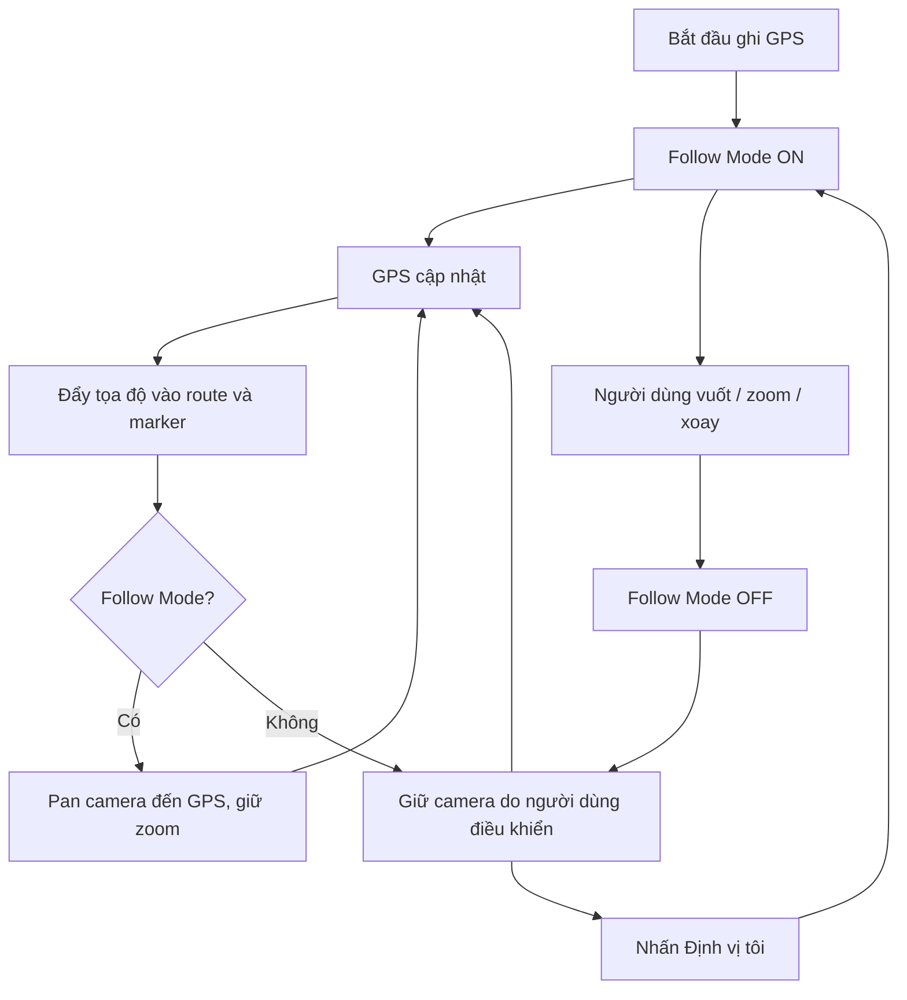

# TrekGO — Hướng dẫn thiết kế tương tác bản đồ

## 1. Mục tiêu

Thiết kế thao tác trên bản đồ cho TrekGO theo từng ngữ cảnh sử dụng. **Không khóa người dùng trong một phạm vi vuốt cố định khi đang ghi GPS**; ưu tiên tự do quan sát địa hình, nhưng có cơ chế quay về vị trí hiện tại và tránh camera tự di chuyển ngoài ý muốn.

## 2. Quy tắc theo màn hình

| Thao tác | Live GPS Tracking | Xem trước/chi tiết cung đường |
|---|---|---|
| Vuốt bản đồ (pan) | Cho phép | Cho phép |
| Phóng to/thu nhỏ (zoom) | Cho phép, có giới hạn | Cho phép |
| Xoay (rotate) | Hạn chế để tránh thao tác nhầm | Cho phép |
| Nghiêng (pitch) | Hạn chế, ưu tiên 2D | Cho phép 3D |
| Theo dõi GPS (Follow Mode) | Có, bật/tắt được | Không bắt buộc |
| Nhấn checkpoint | Cho phép | Cho phép |
| Tự đưa camera về GPS | Chỉ khi Follow Mode bật | Không cần |

### Live GPS Tracking

- Cho phép vuốt bản đồ để xem đường đi, checkpoint và địa hình xung quanh.
- Không đặt `maxBounds` cố định theo một tuyến: người đi trekking có thể đổi tuyến hoặc đi ra ngoài khu vực dự kiến.
- Mặc định có thể dùng bản đồ 2D (`is3D={false}`, `pitch={0}`) để giảm thao tác nhầm và chi phí hiển thị.
- Cung cấp nút **Định vị tôi** để quay về vị trí GPS và bật lại Follow Mode.
- Ghi GPS độc lập với trạng thái camera: vuốt, zoom hay tắt Follow Mode **không được dừng ghi GPS**.

### Xem trước/chi tiết cung đường

- Cho phép khám phá 3D Terrain, xoay và nghiêng.
- Có thể giới hạn vùng camera theo bounding box của tuyến, mở rộng thêm khoảng đệm để người dùng xem đường kết nối và địa hình xung quanh.
- Phạm vi đệm 2–5 km chỉ là ví dụ; cần điều chỉnh theo độ dài và đặc điểm tuyến.

## 3. Đề xuất giới hạn Zoom và Pitch

Trong phần khởi tạo `new maplibregl.Map(...)` của `MapLibre3DView.tsx`, có thể thử cấu hình:

```javascript
const map = new maplibregl.Map({
  container: 'map',
  style: mapStyle,
  center: INITIAL_CENTER,
  zoom: INITIAL_ZOOM,
  minZoom: 10,
  maxZoom: 18,
  pitch: INITIAL_PITCH,
  minPitch: 0,
  maxPitch: 65,
  bearing: INITIAL_BEARING,
  interactive: true,
  dragPan: true,
  scrollZoom: true,
  touchZoomRotate: true,
  dragRotate: false,
  pitchWithRotate: false,
});
```

> **Lưu ý:** `mapStyle` là biến minh họa; trong file thực tế hãy giữ nguyên đối tượng `style` raster/satellite hiện có. Các ngưỡng `minZoom: 10`, `maxZoom: 18`, `maxPitch: 65` là giá trị khởi đầu để thử nghiệm, không phải thông số bắt buộc cho mọi màn hình. Trên thiết bị cảm ứng, cần kiểm tra thêm gesture handler để vô hiệu hóa xoay/nghiêng bằng hai ngón tay nếu muốn khóa hoàn toàn.

| Thông số | Giá trị thử nghiệm | Ý nghĩa |
|---|---:|---|
| `minZoom` | 10 | Hạn chế thu nhỏ quá xa khi ghi GPS |
| `maxZoom` | 18 | Hạn chế phóng vượt mức hữu ích của ảnh vệ tinh |
| `maxPitch` | 65° | Giữ góc nhìn dễ định hướng |
| `dragPan` | `true` | Cho phép vuốt |
| `dragRotate` | `false` | Giảm xoay nhầm trên một số kiểu thao tác |
| `pitchWithRotate` | `false` | Giảm nghiêng nhầm |

## 4. Follow GPS Mode — tính năng ưu tiên

### Quy tắc hành vi

1. Bắt đầu ghi GPS → mặc định bật **Follow Mode**.
2. Khi người dùng **chủ động** vuốt, zoom hoặc xoay bản đồ → tắt Follow Mode.
3. GPS vẫn tiếp tục được ghi và tuyến vẫn được cập nhật trên bản đồ.
4. Nhấn **Định vị tôi** → đưa camera về vị trí hiện tại và bật lại Follow Mode.
5. Trong Follow Mode → chỉ pan camera theo GPS, **giữ nguyên mức zoom** mà người dùng đã chọn.
6. Tránh gọi `flyTo`/`resetCamera` ở mỗi lần nhận GPS vì có thể gây giật hoặc thay đổi zoom ngoài ý muốn.

### Luồng hành vi



### Lưu ý triển khai

- Phân biệt sự kiện camera **do người dùng thao tác** và camera **do ứng dụng chủ động di chuyển**; nếu không, thao tác pan tự động có thể vô tình tắt Follow Mode.
- Có thể dùng một state/ref `followUser` trong React Native và chỉ gọi `centerOnUser` khi bật.
- Không cần thay đổi thuật toán thu thập, lọc hoặc lưu GPS để triển khai Follow Mode.
- Khi mất GPS hoặc mất mạng, không ép camera đến tọa độ giả.

## 5. Khi nào nên dùng `maxBounds`?

MapLibre hỗ trợ giới hạn vùng camera:

```javascript
map.setMaxBounds([
  [108.45, 11.50], // Southwest: [longitude, latitude]
  [108.65, 11.70], // Northeast: [longitude, latitude]
]);
```

**Không dùng vùng ví dụ trên như giới hạn thật của TrekGO.**

- **Không khuyến nghị** `maxBounds` cố định trong Live GPS Tracking.
- **Có thể dùng** trong Trail Preview/Detail nếu tính giới hạn từ tọa độ tuyến và thêm padding.
- Nếu cho phép đổi tuyến, cần cập nhật hoặc bỏ giới hạn camera tương ứng.

## 6. Checkpoint và chế độ Offline

- Cho phép nhấn checkpoint để xem tên, trạng thái và thông tin liên quan.
- Thao tác bản đồ không được làm thay đổi kết quả ghi nhận GPS/checkpoint.
- Khi mất mạng, GPS vẫn được ghi theo thiết kế offline; bản đồ chỉ hiển thị dữ liệu tile đã cache hoặc có sẵn, không giả định rằng toàn bộ bản đồ luôn xem được ngoại tuyến.

## 7. Thứ tự ưu tiên triển khai

1. **Follow GPS Mode** với quy tắc tắt khi người dùng thao tác và bật lại qua nút định vị.
2. Giới hạn zoom/pitch hợp lý cho Live Recorder.
3. Hạn chế xoay/nghiêng nhầm trong lúc ghi GPS.
4. Tùy chọn bounding box + padding cho màn hình xem trước cung đường.
5. Kiểm thử trên iPhone thật: vuốt khi đang ghi, mất GPS, đổi tuyến, tạm dừng/tiếp tục, nhấn định vị và chuyển 2D/3D.

## 8. Kết luận

Đối với TrekGO, **ưu tiên kiểm soát hành vi camera thay vì giới hạn người dùng được vuốt đến đâu**. Live Recorder nên cho phép khám phá bản đồ tự do, giữ GPS tracking độc lập và có Follow Mode dễ bật/tắt. Trail Detail có thể mở rộng khả năng tương tác 3D và tùy chọn giới hạn vùng theo tuyến.
