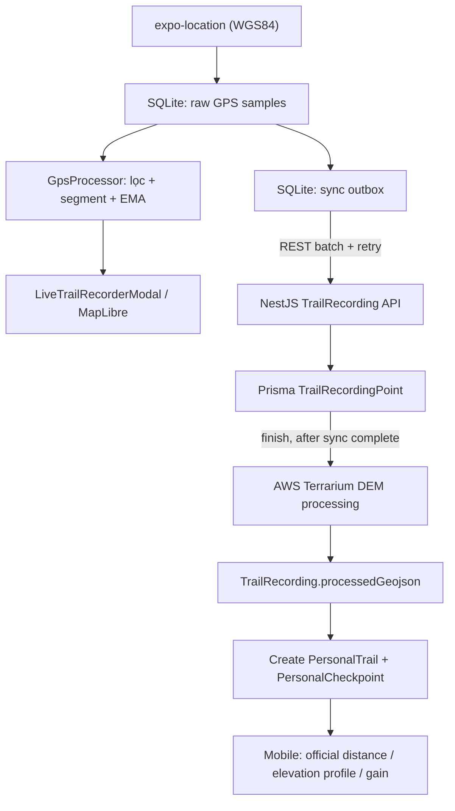

# TrekGO Mobile — Live Trail Recording & Offline Sync

**Phiên bản:** 2.0 · **Ngày:** 15/10/2026  
**Đối tượng:** Mobile team (React Native/Expo), Backend team (NestJS/Prisma)  
**Phạm vi:** Ghi cung đường cá nhân (Personal Trail). **Không thay đổi luồng Trip GPS** (`GpsSession`, `GpsLocation`, `TripActualRoute`).

> **Trạng thái tài liệu:** Đây là **thiết kế mục tiêu và kế hoạch triển khai**, không phải xác nhận code hiện tại đã hỗ trợ. Những tên file hiện có được trích từ mô tả Mobile; cần đối chiếu source trước khi sửa.

## 1. Mục tiêu và quyết định kỹ thuật

Từ mô tả Mobile hiện tại:
- Dùng `expo-location` và `GpsProcessor` (`src/utils/gpsProcessor.ts`); theo mô tả, nhận mẫu mỗi 1 giây hoặc dịch chuyển ≥1 m, lọc `accuracy ≤25m`, ngưỡng vận tốc 4.5 m/s, EMA độ cao alpha 0.2, tách segment khi Pause/Resume hoặc mất GPS >15 giây.
- `LiveTrailRecorderModal` (`src/components/trail/LiveTrailRecorderModal`) hiển thị thời gian, khoảng cách, độ cao tích lũy, đánh dấu checkpoint.
- Hiện lưu `PersonalTrail` vào AsyncStorage key `@trekgo/personal-trails-v1` và gửi `POST /api/v1/personal-trails`.

**Thiết kế đề xuất:**
1. **SQLite là nguồn dữ liệu cục bộ cho raw GPS + offline sync outbox**. AsyncStorage tiếp tục giữ preferences và cache metadata, không dùng để chứa một JSON lớn gồm hàng nghìn điểm GPS.
2. **Lưu raw sample trước khi chạy filter**; filter chỉ quyết định điểm nào tham gia live route/metrics. Có thể ghi `accepted`/`rejectReason` vào SQLite. Nếu backend cần toàn bộ raw kể cả rejected, phải thống nhất API và schema trước khi bật gửi.
3. **Live elevation và gain là provisional**. Độ cao gốc từ `expo-location` giữ nguyên (nullable); EMA chỉ dùng live UI. Backend tính kết quả chính thức từ AWS Terrarium DEM sau khi kết thúc và sync xong.
4. **Canonical route là GeoJSON `MultiLineString`** để không vẽ đường nối xuyên qua quãng Pause hoặc mất GPS; mỗi segment hợp lệ có ≥2 điểm.
5. **Recording khác PersonalTrail**: `TrailRecording` lưu phiên và điểm GPS; `PersonalTrail` là cung đường đã được tạo từ kết quả xử lý.
6. Giữ PostgreSQL + Prisma hiện có, không chuyển MongoDB hay yêu cầu PostGIS cho MVP.

## 2. Luồng tổng thể



### Các trạng thái trên Mobile

`RECORDING` → `PAUSED` ↔ `RECORDING` → `STOPPED_LOCAL` → `PENDING_SYNC` → `PROCESSING` → `READY`.

`SYNC_FAILED` và `PROCESSING_FAILED` là trạng thái lỗi có thể retry; **không xóa local raw** khi chưa nhận xác nhận backend và chưa đảm bảo phục hồi. `STOPPED_LOCAL` chỉ có nghĩa là người dùng đã dừng trên thiết bị, không có nghĩa DEM đã xử lý.

## 3. Mô hình dữ liệu TypeScript trên Mobile

```ts
export type RecordingStatus =
  | 'RECORDING' | 'PAUSED' | 'STOPPED_LOCAL'
  | 'PENDING_SYNC' | 'SYNC_FAILED' | 'PROCESSING'
  | 'PROCESSING_FAILED' | 'READY';

export interface RawGpsSample {
  clientSampleId: string; // UUID ổn định qua retry
  clientRecordingId: string; // UUID local, ổn định qua restart
  latitude: number;
  longitude: number;
  recordedAt: string; // ISO 8601 UTC
  accuracyM: number | null;
  altitudeM: number | null; // giá trị gốc từ location.coords.altitude
  altitudeAccuracyM: number | null;
  speedMps: number | null;
  headingDeg: number | null;
  segmentId: number;
  accepted: boolean; // quyết định filter trên mobile
  rejectReason?: 'LOW_ACCURACY' | 'SPEED_OUTLIER' | 'INVALID_COORDS';
}

export interface LiveGpsPoint {
  clientSampleId: string;
  latitude: number;
  longitude: number;
  segmentId: number;
  elevationSmoothedM: number | null; // CHỈ UI, không ghi đè raw altitudeM
  recordedAt: string;
}

export interface LocalRecording {
  clientRecordingId: string;
  serverRecordingId: string | null;
  status: RecordingStatus;
  startedAt: string;
  endedAt: string | null;
  nextSegmentId: number;
  lastSyncedAt: string | null;
  serverPersonalTrailId: string | null;
}

export interface LocalCheckpoint {
  clientCheckpointId: string;
  clientRecordingId: string;
  name: string;
  order: number;
  latitude: number | null;
  longitude: number | null;
  recordedAt: string;
  distanceFromStartKm: number | null;
  elevationLiveM: number | null;
}
```

**Không dùng** `0` để biểu diễn độ cao không xác định. Không gửi `elevationSmoothedM` thành `altitudeM`. Với sample rejected, vẫn giữ raw trong SQLite; chính sách gửi rejected samples lên server là một quyết định contract riêng.

## 4. SQLite local-first

**Đề xuất thư viện:** `expo-sqlite` phù hợp hệ sinh thái Expo. Không cần chuyển toàn bộ cache AsyncStorage sang SQLite ngay; chỉ dữ liệu ghi GPS, checkpoints, outbox và trạng thái đồng bộ.

```sql
CREATE TABLE IF NOT EXISTS local_recordings (
  client_recording_id TEXT PRIMARY KEY,
  server_recording_id TEXT,
  status TEXT NOT NULL,
  started_at TEXT NOT NULL,
  ended_at TEXT,
  next_segment_id INTEGER NOT NULL DEFAULT 0,
  server_personal_trail_id TEXT,
  last_synced_at TEXT
);

CREATE TABLE IF NOT EXISTS raw_gps_samples (
  client_sample_id TEXT PRIMARY KEY,
  client_recording_id TEXT NOT NULL,
  latitude REAL NOT NULL,
  longitude REAL NOT NULL,
  recorded_at TEXT NOT NULL,
  accuracy_m REAL,
  altitude_m REAL,
  altitude_accuracy_m REAL,
  speed_mps REAL,
  heading_deg REAL,
  segment_id INTEGER NOT NULL DEFAULT 0,
  accepted INTEGER NOT NULL,
  reject_reason TEXT,
  synced INTEGER NOT NULL DEFAULT 0,
  FOREIGN KEY (client_recording_id) REFERENCES local_recordings(client_recording_id)
);
CREATE INDEX IF NOT EXISTS idx_samples_pending
  ON raw_gps_samples(client_recording_id, synced, recorded_at);

CREATE TABLE IF NOT EXISTS local_checkpoints (
  client_checkpoint_id TEXT PRIMARY KEY,
  client_recording_id TEXT NOT NULL,
  name TEXT NOT NULL,
  order_index INTEGER NOT NULL,
  latitude REAL,
  longitude REAL,
  recorded_at TEXT NOT NULL,
  distance_from_start_km REAL,
  elevation_live_m REAL
);

CREATE TABLE IF NOT EXISTS sync_outbox (
  id TEXT PRIMARY KEY,
  client_recording_id TEXT NOT NULL,
  operation TEXT NOT NULL,
  payload_json TEXT NOT NULL,
  state TEXT NOT NULL DEFAULT 'PENDING',
  attempt_count INTEGER NOT NULL DEFAULT 0,
  next_retry_at TEXT,
  created_at TEXT NOT NULL
);
```

**Ghi nhận:** insert raw sample vào SQLite **trước** khi cập nhật UI. Nên gộp insert sample và tạo pending work vào transaction. Không dùng `setState` làm nguồn dữ liệu duy nhất; sau khi app restart, hydrate từ SQLite.

**Đồng bộ:** serialize theo recording, batch theo thứ tự thời gian, chỉ đánh dấu `synced=1` khi backend ACK. Dùng UUID `clientSampleId` bất biến. Retry exponential backoff có jitter, kiểm tra auth và network; tránh gọi API đồng thời trùng batch. Khi token hết hạn, dừng retry đến khi refresh auth thành công.

**Giới hạn nền:** Expo background location cần kiểm tra quyền, cấu hình build, giới hạn iOS/Android và điều kiện hệ điều hành. Không cam kết tracking liên tục khi app bị force-stop hoặc OS hạn chế. Hiển thị rõ tình trạng ghi nhận và cảnh báo thiếu dữ liệu.

## 5. Quy tắc GPS processor

- **Thu mẫu:** thông số `1s / 1m` trong tài liệu cũ là cấu hình mục tiêu, không đảm bảo OS sẽ phát đúng nhịp; nên cấu hình dựa trên mức tiêu hao pin và độ ổn định thực tế.
- **Accuracy:** ngưỡng 25 m là mặc định ban đầu, có thể cấu hình; rejected sample vẫn giữ raw.
- **Speed:** 4.5 m/s chỉ là heuristic cho trekking; không loại bỏ điểm chỉ vì người dùng di chuyển nhanh (ví dụ đi xe tới trailhead) nếu chưa xác định trạng thái. Dùng khoảng cách/thời gian giữa các accepted points để phát hiện teleport, xét accuracy và thời gian.
- **Segment:** tăng segment khi Resume hoặc gap >15 s; không cộng distance/elevation gain qua ranh giới segment. Không nối đường giữa hai segment.
- **EMA altitude:** alpha 0.2 chỉ dùng hiển thị live; reset trạng thái EMA ở segment mới; tránh cộng gain từ nhiễu cao độ.
- **Distance:** tính geodesic/Haversine giữa các điểm accepted cùng segment; tránh cộng khi accuracy quá thấp hoặc khoảng cách vượt khả năng hợp lý.
- **Timestamp:** giữ `recordedAt` từ thiết bị; backend kiểm tra timestamp bất thường. Cần thứ tự ổn định `(recordedAt, clientSampleId)` khi timestamps trùng.
- **Độ cao:** GPS raw altitude có thể thiếu/không chính xác; khi DEM không có giá trị, đánh dấu missing, không tự gán 0 m.

## 6. GeoJSON và Tactical Map

**Định dạng chuẩn lưu backend:**

```json
{
  "type": "MultiLineString",
  "coordinates": [
    [[108.52904, 11.58312, 1120], [108.52918, 11.58325, 1124]],
    [[108.53120, 11.58580, 1180], [108.53145, 11.58610, 1192]]
  ]
}
```

`gpsSegments` trong tài liệu Mobile cũ là **mảng coordinates**, không phải GeoJSON object đầy đủ. `gpsRoute` là bản flatten làm mất ranh giới Pause; **không dùng làm canonical geometry**. `routePoints` có `x/y` (0..400) là tọa độ UI Tactical Map; tính từ route khi render, không coi là tọa độ địa lý chính thức.

Mỗi segment hợp lệ của `MultiLineString` phải có ít nhất 2 điểm. Điểm đơn lẻ giữ trong raw GPS nhưng không tạo line. GeoJSON có thể chứa `[lng,lat]` khi chưa có độ cao; không dùng `null` ở phần tử thứ ba trong position. Để tránh trộn độ cao GPS và DEM trong cùng route chính thức, chỉ xuất `3D` cho những điểm có DEM hợp lệ và ghi metadata coverage; tùy renderer có thể chọn route 2D đồng nhất và elevation profile riêng khi DEM bị thiếu nhiều.

## 7. Checkpoints cá nhân

Mobile hiện có `Checkpoint` với `id`, `order`, `name`, `elevation`, `distanceFromStartKm`, `status`, `realCoords`, `coords.x/y`.

**Map với `PersonalCheckpoint` hiện tại:**

| Mobile | Prisma | Ghi chú |
|---|---|---|
| `name` | `name` | Tên checkpoint |
| `order` | `sequence` | Bảo đảm duy nhất theo trail |
| `realCoords.lat` | `latitude` | Bắt buộc khi tạo checkpoint chính thức |
| `realCoords.lon` | `longitude` | Bắt buộc khi tạo checkpoint chính thức |
| `elevation` | Chưa có field tương ứng | Có thể lấy từ DEM/profile khi hiển thị; chỉ thêm field nếu thật sự cần |
| `distanceFromStartKm` | Chưa có field tương ứng | Tính từ route processed, không tin tuyệt đối client |
| `status` | Không có | Đây là trạng thái ghi trên Mobile, không phải thuộc tính checkpoint tĩnh |
| `coords.x/y` | Không có | Chỉ UI, không lưu canonical DB |
| — | `radiusMeters` | Backend có mặc định 50 m |

Nếu người dùng đánh dấu checkpoint khi GPS không hợp lệ, lưu checkpoint dạng draft local; yêu cầu chỉnh tọa độ hoặc gắn lại vào tuyến trước khi gửi backend. Không tự tạo `CheckpointEvent` thuộc Trip.

## 8. API contract Mobile ↔ Backend (đề xuất)

> **Các endpoint dưới đây là mục tiêu triển khai**, chưa xác minh controller thực tế. Không triển khai client dựa vào tên endpoint nếu BE chưa thống nhất DTO và response.

### 8.1 Create recording

`POST /api/v1/trail-recordings`

```json
{
  "clientRecordingId": "a3496d12-4055-4fcb-b2a2-6cb5ef85c001",
  "startedAt": "2026-10-15T08:00:00.000Z"
}
```

Server lấy `userId` từ JWT, không nhận quyền sở hữu do client tự khai. Để idempotent create khi retry, backend cần unique `clientRecordingId` theo user (hoặc mapping tương đương); field này **chưa có** trong schema hiện tại.

### 8.2 Batch GPS points

`POST /api/v1/trail-recordings/:recordingId/points:batch`

```json
{
  "points": [
    {
      "clientSampleId": "de9e51ae-c2cc-4aa2-aed6-67698334a291",
      "latitude": 11.58312,
      "longitude": 108.52904,
      "accuracyM": 6.5,
      "speedMps": 1.1,
      "headingDeg": null,
      "altitudeM": 1120,
      "altitudeAccuracyM": 4.2,
      "segmentId": 0,
      "recordedAt": "2026-10-15T08:00:01.000Z"
    }
  ]
}
```

Server đã có `@@unique([recordingId, clientSampleId])` ở `TrailRecordingPoint`; tận dụng để chống trùng. Cần **bổ sung** `segmentId` và `altitudeAccuracyM` nếu áp dụng contract này. `accepted`/`rejectReason` chỉ gửi nếu BE bổ sung schema tương ứng; phương án MVP có thể sync accepted points, nhưng lúc đó server **không giữ toàn bộ raw**. Nếu mục tiêu là bảo toàn raw end-to-end, bổ sung 2 field này và sync cả rejected points.

**ACK** nên chứa `acceptedCount`, `duplicateCount`, `rejectedCount` và `clientSampleIds` lỗi có thể sửa, để Mobile không đánh dấu sync nhầm. Có thể chia batch khoảng 100–300 điểm rồi benchmark trên mạng yếu; đây là thông số thử nghiệm, không phải giới hạn bắt buộc.

### 8.3 Finish + processing

`POST /api/v1/trail-recordings/:recordingId/finish`

Chỉ gọi khi không còn sample chưa sync; server cần xác minh completeness (ví dụ `expectedSampleCount` hoặc sequence) và xử lý idempotent. Response `202 Accepted` với processing status; Mobile poll `GET /api/v1/trail-recordings/:recordingId` (hoặc push nếu hệ thống đã có kênh thông báo). Không báo READY ngay khi nhận 202.

### 8.4 Create personal trail from recording

`POST /api/v1/trail-recordings/:recordingId/personal-trail`

```json
{
  "title": "Cung đường Sống Khủng Long Tà Năng",
  "description": "Chuyến trekking buổi sáng",
  "difficulty": "MEDIUM",
  "visibility": "PRIVATE",
  "checkpoints": [
    {"clientCheckpointId": "cp-rec-1773562300000", "name": "Trạm kiểm lâm", "sequence": 1, "latitude": 11.58312, "longitude": 108.52904}
  ]
}
```

Server tạo `PersonalTrail` và `PersonalCheckpoint` bằng transaction, lấy route/distance/gain **từ kết quả processed**, không tin số đo provisional từ client. Gắn `TrailRecording.createdPersonalTrailId` để chống tạo trùng khi retry. Nếu BE muốn auto-create trail ngay khi processing xong, có thể hợp nhất bước này nhưng phải thống nhất UX chỉnh tên/checkpoints.

### 8.5 Trạng thái, quyền riêng tư và kiểm duyệt

- `GET /api/v1/trail-recordings/:id`: sync/processing status, lỗi, metrics chính thức.
- `GET /api/v1/personal-trails/:id`: thông tin trail và geometry theo quyền.
- Schema hiện tại `PersonalTrail.visibility` chỉ có **`PRIVATE` / `SHARED`**, không có `PUBLIC`.
- Schema hiện tại `PersonalTrail` **không có `verificationStatus`**. Xét duyệt/chuyển thành system trail phải đi theo `TrailSubmission` hiện hữu, không cho Mobile gửi `VERIFIED` để tự duyệt.
- `difficulty` Mobile tiếng Việt cần map sang enum `EASY / MEDIUM / HARD / EXTREME` trước khi gửi API.
- `ownerId`, `verificationStatus`, `elevationGainM` trong payload Mobile cũ không phải nguồn dữ liệu đáng tin để server ghi trực tiếp.

## 9. Backend schema delta tối thiểu (đề xuất, chưa chỉnh file schema)

```prisma
// Thêm vào model TrailRecordingPoint hiện có:
segmentId         Int      @default(0) @map("segment_id")
altitudeAccuracyM Decimal? @map("altitude_accuracy_m") @db.Decimal(7, 2)

// Nếu cần audit raw sample rejected end-to-end, cân nhắc thêm:
// accepted     Boolean @default(true)
// rejectReason String? @map("reject_reason") @db.VarChar(50)

// Đề xuất index nếu volume lớn:
// @@index([recordingId, segmentId, recordedAt])
```

Ngoài ra cần cơ chế idempotency cho `clientRecordingId` ở `TrailRecording` (có thể thêm `clientRecordingId String? @map("client_recording_id") @db.Uuid` và `@@unique([userId, clientRecordingId])`; kiểm tra tác động dữ liệu cũ trước migration). Không đổi `GpsSession`, `GpsLocation` hay `TripActualRoute` trong đợt này.

## 10. Đồng bộ dữ liệu cũ AsyncStorage

Key cũ: `@trekgo/personal-trails-v1`.

1. Đọc dữ liệu cũ ở chế độ read-only, kiểm tra schema/version và backup bản gốc.
2. Với draft chưa có server ID: tạo `clientRecordingId` ổn định; chuyển geometry/checkpoint metadata sang SQLite; nếu dữ liệu cũ chỉ có `gpsRoute`/`gpsSegments` mà không có timestamp từng điểm, **không giả tạo raw GPS timestamp/accuracy**.
3. Với trail đã đồng bộ: giữ mapping `serverPersonalTrailId`, không tạo lại bản ghi.
4. Đánh dấu migration hoàn thành sau khi kiểm tra số lượng/ID/checkpoints; chưa xóa key cũ ngay.
5. Nếu không thể tái tạo recording từ legacy payload, cho phép **legacy import PersonalTrail** qua endpoint riêng có validation, đánh dấu provenance là imported/legacy; không tuyên bố đã được DEM xử lý nếu chưa xử lý.

## 11. Kế hoạch triển khai theo PR

| PR | Phạm vi | Tiêu chí hoàn thành |
|---|---|---|
| M1 | SQLite schema + migration từ AsyncStorage | Restart app không mất draft/recording |
| M2 | Capture raw trước filter + segment | Raw/accepted phân biệt; pause/resume không nối đường |
| B1 | Prisma migration + idempotent create/batch API | Retry không sinh duplicate |
| M3 | Sync outbox + ACK/retry | Offline → online sync chính xác, không mất point |
| B2 | Finish + AWS Terrarium + processed GeoJSON | Distance/gain chính thức; DEM missing được xử lý |
| B3 | Create PersonalTrail + PersonalCheckpoint | Không tạo trùng, đúng enum và quyền sở hữu |
| M4 | UI provisional/official + sync state | User phân biệt đang ghi/đang sync/đã xử lý |
| QA | Field test Android/iOS | GPS gap, app kill, pin yếu, mạng yếu, 10k+ điểm |

## 12. Checklist kiểm thử bắt buộc

- [ ] Mất mạng 30 phút khi ghi, vẫn có raw GPS và checkpoint.
- [ ] App crash/restart khôi phục recording và trạng thái sync; không tự giả định tracking vẫn hoạt động khi OS dừng app.
- [ ] Pause/Resume và gap >15s tạo segment mới, không nối khoảng trống.
- [ ] Một batch gửi lại 3 lần chỉ tạo mỗi `clientSampleId` một lần.
- [ ] Batch ACK một phần không làm mất sample lỗi.
- [ ] `altitudeM = null` không bị biến thành 0.
- [ ] Live gain và official DEM gain được gắn nhãn rõ ràng.
- [ ] Một segment chỉ có một điểm không làm GeoJSON invalid.
- [ ] Checkpoint thiếu GPS vẫn là draft, không ghi tọa độ bịa.
- [ ] Tạo PersonalTrail retry không sinh duplicate.
- [ ] Người dùng không thể truy cập recording/trail của người khác.
- [ ] Dữ liệu AsyncStorage cũ được bảo toàn khi migration.

## 13. Những quyết định cần chốt giữa Mobile và Backend

1. **Raw end-to-end hay accepted-only?** Khuyến nghị raw end-to-end để tái xử lý filter, nhưng cần thêm `accepted/rejectReason` và giới hạn retention/privacy. MVP đơn giản hơn có thể accepted-only và ghi rõ hạn chế.
2. **Khi nào tạo PersonalTrail?** Khuyến nghị sau khi processing READY; giữ draft metadata/checkpoints ở Mobile trong lúc chờ.
3. **Bản đồ khi DEM thiếu?** Khuyến nghị tuyến 2D + profile thiếu dữ liệu có nhãn, không suy đoán 0m.
4. **Chính sách retention:** chốt thời gian lưu raw local/server và xóa có xác nhận, phù hợp yêu cầu riêng tư.
5. **Background tracking:** kiểm tra cấu hình Expo/OS thực tế, quyền vị trí và trải nghiệm người dùng trước khi hứa hoạt động liên tục.

---

## 14. Tài liệu đối chiếu

- Mô tả Mobile do nhóm cung cấp: `Markdown đã dán (1).md` — cấu trúc `GpsPoint`, `PersonalTrail`, checkpoint, AsyncStorage và payload hiện tại.
- Database hiện tại: `schema.prisma` — `TrailRecording`, `TrailRecordingPoint`, `PersonalTrail`, `PersonalCheckpoint`, `TrailSubmission`.
- Backend DEM: `TrekGO_AWS_Terrarium_Elevation_Implementation_v2_1.md` — luồng AWS Terrarium và quyết định đồng bộ.

**Nguyên tắc:** Không sửa chức năng Trip GPS/Area C khác khi triển khai luồng Personal Trail Recording.
