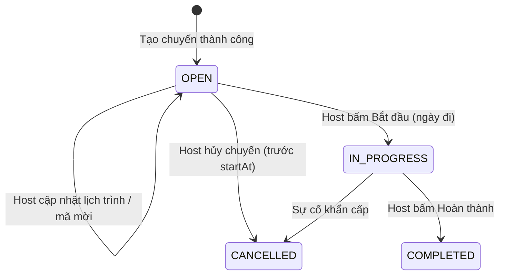
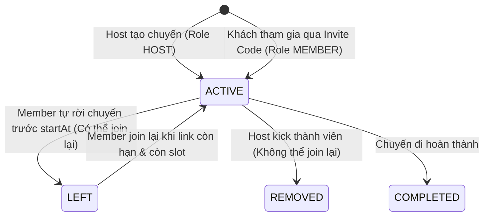
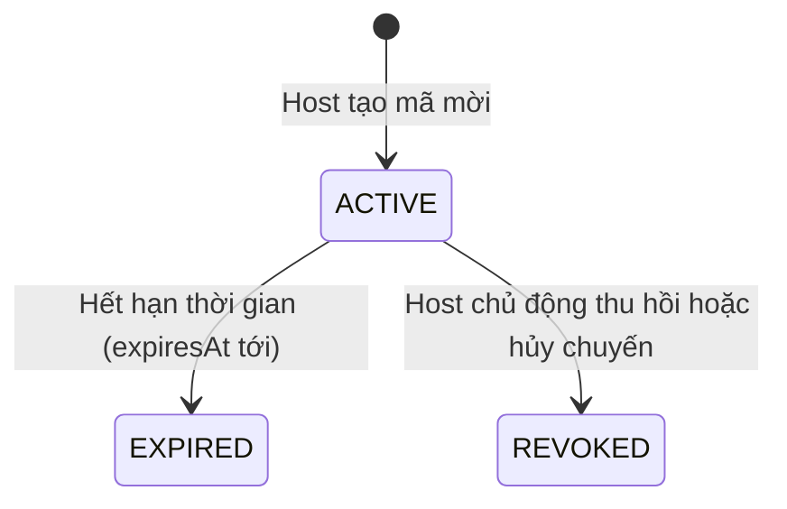
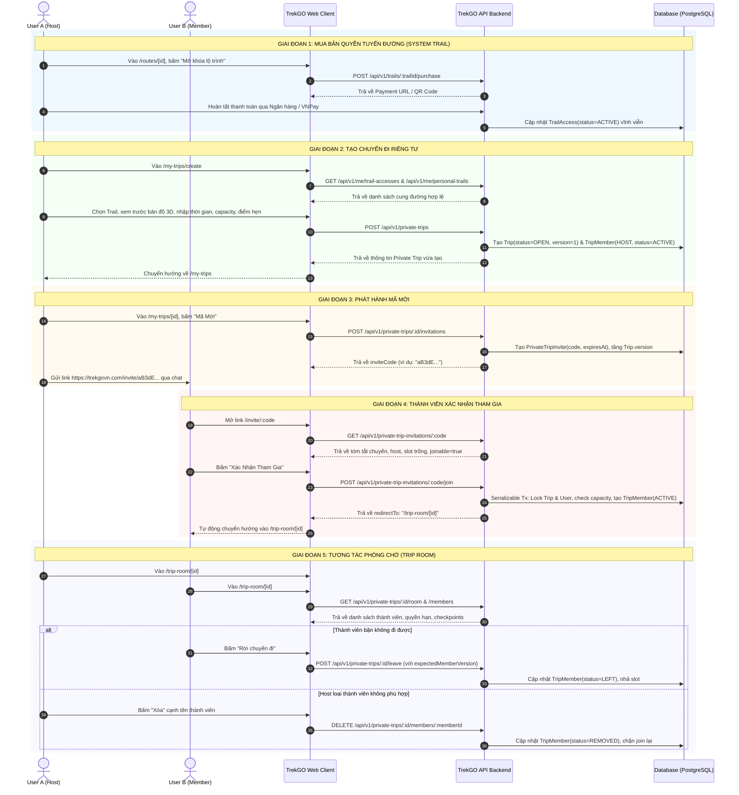

# HƯỚNG DẪN KỸ THUẬT & TÀI LIỆU LUỒNG PRIVATE TRIP (CHUYẾN ĐI RIÊNG TƯ)

> **Dành cho:** AI Coding Assistant, Backend Developer, Frontend Developer  
> **Mục đích:** Đặc tả toàn bộ kiến trúc, luồng dữ liệu, quy tắc nghiệp vụ, state machine, danh mục API và bản đồ ghép nối màn hình (UI-to-API Mapping) cho tính năng **Private Trip (CF03 / CF04)** trên hệ thống **Vina TrekGO**.

---

## 1. TỔNG QUAN NGHIỆP VỤ (DOMAIN OVERVIEW & CORE RULES)

### 1.1. Bản chất của Private Trip
* **Private Trip** là chuyến đi trekking tự túc do người dùng tự tổ chức cho nhóm bạn bè, người thân hoặc câu lạc bộ riêng.
* **Không thương mại hóa:** Không bán slot công khai, không thu tiền vé qua cổng thanh toán TrekGO Booking, không xuất hiện trên bảng khám phá công khai (Public Discovery).
* **Cơ chế tham gia:** Dùng **Mã mời (Invite Code / Link)** đa dụng (multi-use). Người được mời có tài khoản TrekGO chỉ cần nhấn tham gia là được vào nhóm ngay (nếu chuyến đi còn slot trống), không cần Host phê duyệt.

### 1.2. Các quy tắc nghiệp vụ bất biến (Business Invariants)
1. **Phân quyền tạo chuyến (Role Guard):**
   * Chỉ tài khoản có role **`USER`** đang `ACTIVE` mới được tạo Private Trip.
   * Role **`LEADER` bị chặn hoàn toàn** (`403 LEADER_CANNOT_CREATE_PRIVATE_TRIP`) trong MVP để tránh xung đột lợi ích và lách kiểm duyệt.
2. **Nguồn cung đường hợp lệ (Trail Source Invariant):**
   * Chỉ được tạo từ 2 nguồn:
     * **`PERSONAL` (Personal Trail):** Cung đường do chính User tự ghi GPS / upload GeoJSON.
     * **`SYSTEM` (System Trail):** Cung đường hệ thống TrekGO mà User đã thanh toán mua quyền sử dụng vĩnh viễn (`TrailAccess` có trạng thái `ACTIVE`). Nếu chưa mua mà cố tình tạo $\rightarrow$ báo lỗi `403 TRAIL_ACCESS_REQUIRED`.
3. **Quy mô & Lịch trình (Schedule & Capacity):**
   * Thời gian: `now < startAt < endAt`. Không cho phép tạo hoặc sửa lùi về quá khứ.
   * Sức chứa (`capacity` / `maxPax`): Số nguyên dương $\ge 1$. Sức chứa này **đã bao gồm cả Host**.
   * Khi sửa chuyến (`PATCH`): Không được giảm `capacity` xuống thấp hơn số lượng thành viên đang `ACTIVE`.
4. **Mã mời (Invite Policy):**
   * Mã mời có định dạng chuỗi an toàn, có thời hạn hiệu lực (`expiresAt`).
   * Bắt buộc: `now < expiresAt < startAt` (Mã mời phải hết hạn trước khi chuyến đi bắt đầu).
   * Host có quyền tạo lại (regenerate) hoặc thu hồi (revoke) mã mời bất cứ lúc nào.
5. **Cơ chế thành viên (Membership Rules):**
   * Người tạo chuyến tự động là thành viên đầu tiên với role **`HOST`**, trạng thái `ACTIVE`.
   * Khách mời tham gia với role **`MEMBER`**, trạng thái `ACTIVE`.
   * **Tự rời nhóm (Leave):** Member được quyền tự rời nhóm trước giờ khởi hành $\rightarrow$ chuyển trạng thái `LEFT`, giải phóng 1 slot. Member ở trạng thái `LEFT` có thể dùng lại mã mời để join lại.
   * **Host loại thành viên (Kick/Remove):** Host có quyền kick member ra khỏi nhóm $\rightarrow$ trạng thái `REMOVED`. Người bị `REMOVED` **không thể tự join lại** bằng mã mời.
   * **Bảo vệ Host:** Không ai được kick Host, và Host không thể tự bấm rời nhóm (muốn hủy nhóm thì Host phải dùng chức năng Cancel Trip).

---

## 2. MÁY TRẠNG THÁI (STATE MACHINES)

### 2.1. Vòng đời Chuyến đi (Trip State)


### 2.2. Vòng đời Thành viên (TripMember State)


### 2.3. Vòng đời Mã mời (PrivateTripInvite State)


---

## 3. SƠ ĐỒ LUỒNG TỔNG THỂ (END-TO-END FLOW)



---

## 4. CHI TIẾT DANH MỤC API (API CONTRACT SPECIFICATIONS)

> **Lưu ý chung:**
> * Tất cả API đều có tiền tố `/api/v1` (trừ một số Next.js internal rewrite proxy).
> * Header xác thực bắt buộc (trừ các endpoint public preview): `Authorization: Bearer <access_token>`.
> * Cấu trúc Response lỗi chuẩn:
>   ```json
>   {
>     "error": {
>       "code": "CAPACITY_CONFLICT",
>       "message": "Chuyến đi đã đủ người tham gia.",
>       "details": {},
>       "retryable": false
>     },
>     "meta": {
>       "requestId": "uuid",
>       "serverTime": "2026-10-15T10:00:00.000Z",
>       "contractVersion": "v1"
>     }
>   }
>   ```

---

### PHẦN A: NGUỒN CUNG ĐƯỜNG & ĐIỂM TẬP KẾT

#### 1. Mua quyền sử dụng System Trail
* **Endpoint:** `POST /api/v1/trails/:trailId/purchase`
* **Quyền:** `USER`
* **Request Body:**
  ```json
  {
    "paymentMethod": "QR" // hoặc "REDIRECT"
  }
  ```
* **Response (200 OK):**
  ```json
  {
    "purchaseId": "uuid",
    "amount": 50000,
    "paymentRef": "PAY-123456",
    "checkoutUrl": "https://pay.trekgovn.com/checkout/..."
  }
  ```

#### 2. Lấy danh sách System Trail đã mua quyền
* **Endpoint:** `GET /api/v1/me/trail-accesses?page=1`
* **Quyền:** `USER`
* **Response (200 OK):** Mảng các `TrailAccess` kèm thông tin `systemTrail` và checkpoints:
  ```json
  [
    {
      "id": "access-uuid",
      "systemTrailId": "trail-uuid",
      "status": "ACTIVE",
      "systemTrail": {
        "id": "trail-uuid",
        "name": "Tà Năng - Phan Dũng",
        "destinationId": "dest-uuid",
        "trailCheckpointsViaSystemTrailId": [
          {
            "sequence": 1,
            "checkpoint": { "id": "cp-1", "name": "Đồi Lính", "status": "ACTIVE", "destinationId": "dest-uuid" }
          }
        ]
      }
    }
  ]
  ```

#### 3. Lấy danh sách Personal Trail của User
* **Endpoint:** `GET /api/v1/me/personal-trails?page=1`
* **Quyền:** `USER`
* **Response (200 OK):**
  ```json
  [
    {
      "id": "personal-trail-uuid",
      "title": "Cung đường săn mây tự vẽ",
      "destinationId": "dest-uuid",
      "personalCheckpointsViaPersonalTrailId": [
        { "id": "pcp-1", "name": "Trạm dừng chân 1", "sequence": 1 }
      ]
    }
  ]
  ```

#### 4. Lấy danh sách Điểm tập kết (Pickup Points) theo địa điểm
* **Endpoint:** `GET /api/v1/private-trip-options/pickup-points?destinationId=:destinationId&page=1`
* **Quyền:** `USER`
* **Response (200 OK):**
  ```json
  [
    {
      "id": "pickup-uuid-1",
      "name": "Bến xe Miền Đông Mới",
      "address": "TP. Thủ Đức, TP.HCM",
      "latitude": 10.87,
      "longitude": 106.80
    }
  ]
  ```

---

### PHẦN B: QUẢN LÝ CHUYẾN ĐI (CF03 - PRIVATE TRIPS)

#### 5. Tạo chuyến đi riêng tư (Create Private Trip)
* **Endpoint:** `POST /api/v1/private-trips`
* **Quyền:** `USER` (Role `LEADER` bị từ chối 403)
* **Request Body:**
  ```json
  {
    "title": "Cuối tuần leo núi cùng bạn thân",
    "description": "Mang theo lều và đồ ấm cá nhân",
    "startAt": "2026-10-25T05:00:00.000Z",
    "endAt": "2026-10-26T18:00:00.000Z",
    "capacity": 6,
    "pickupPointId": "pickup-uuid-1",
    "type": "SYSTEM", // hoặc "PERSONAL"
    "trailRef": "trail-uuid",
    "destinationId": "dest-uuid",
    "checkpointIds": ["cp-1", "cp-2"]
  }
  ```
* **Response (201 Created):**
  ```json
  {
    "id": "trip-uuid",
    "tripType": "PRIVATE",
    "title": "Cuối tuần leo núi cùng bạn thân",
    "description": "Mang theo lều và đồ ấm cá nhân",
    "startAt": "2026-10-25T05:00:00.000Z",
    "endAt": "2026-10-26T18:00:00.000Z",
    "maxPax": 6,
    "pickupPointId": "pickup-uuid-1",
    "destinationId": "dest-uuid",
    "status": "OPEN",
    "version": 1
  }
  ```

#### 6. Lấy danh sách chuyến đi do mình làm Host
* **Endpoint:** `GET /api/v1/private-trips?page=1`
* **Quyền:** `USER`
* **Response (200 OK):** Mảng các `PrivateTrip`.

#### 7. Chi tiết chuyến đi (Host Management View)
* **Endpoint:** `GET /api/v1/private-trips/:id`
* **Quyền:** `USER` (Phải là creator/Host của chuyến đi)
* **Response (200 OK):** Bao gồm thông tin cơ bản, `tripTrailPlansViaTripId` (chứa `snapshotGeojson`) và `tripCheckpointsViaTripId`.

#### 8. Sửa lịch trình chuyến đi
* **Endpoint:** `PATCH /api/v1/private-trips/:id`
* **Quyền:** `HOST` (Chuyến phải đang `OPEN` và `now < startAt`)
* **Request Body:**
  ```json
  {
    "expectedVersion": 1,
    "title": "Tên mới nếu muốn đổi",
    "description": "Mô tả cập nhật",
    "startAt": "2026-10-25T06:00:00.000Z",
    "endAt": "2026-10-26T19:00:00.000Z",
    "capacity": 8, // Không được nhỏ hơn số member ACTIVE hiện tại
    "pickupPointId": "pickup-uuid-2"
  }
  ```
* **Response (200 OK):** Object `PrivateTrip` với `version` tăng lên 2.

#### 9. Tạo hoặc Đổi mã mời (Generate / Regenerate Invite)
* **Endpoint:** `POST /api/v1/private-trips/:id/invitations`
* **Quyền:** `HOST`
* **Request Body:**
  ```json
  {
    "expectedVersion": 1,
    "expiresAt": "2026-10-24T23:59:59.000Z" // Tùy chọn, phải trước startAt
  }
  ```
* **Response (201 Created):**
  ```json
  {
    "tripId": "trip-uuid",
    "inviteCode": "b9X7qL2kM4",
    "expiresAt": "2026-10-24T23:59:59.000Z",
    "tripVersion": 2
  }
  ```

#### 10. Thu hồi mã mời (Revoke Invite)
* **Endpoint:** `POST /api/v1/private-trips/:id/invitations/revoke`
* **Quyền:** `HOST`
* **Request Body:**
  ```json
  {
    "expectedVersion": 2
  }
  ```
* **Response (200 OK):** `{ "tripId": "trip-uuid", "revokedCount": 1, "tripVersion": 3 }`

#### 11. Hủy chuyến đi riêng tư (Cancel Private Trip)
* **Endpoint:** `POST /api/v1/private-trips/:id/cancel`
* **Quyền:** `HOST` (Chuyến đang `OPEN` trước `startAt`)
* **Request Body:**
  ```json
  {
    "expectedVersion": 2,
    "reason": "Thời tiết xấu, bão lớn"
  }
  ```
* **Response (201 Created):** Chuyến đi chuyển trạng thái `CANCELLED`, mọi mã mời bị thu hồi.

---

### PHẦN C: THÀNH VIÊN & PHÒNG CHỜ (CF04 - MEMBERSHIP & ROOM)

#### 12. Xem trước thư mời công khai (Invite Preview)
* **Endpoint:** `GET /api/v1/private-trip-invitations/:code`
* **Quyền:** Public (Không cần Token xác thực)
* **Response (200 OK):**
  ```json
  {
    "trip": {
      "id": "trip-uuid",
      "tripType": "PRIVATE",
      "title": "Cuối tuần leo núi cùng bạn thân",
      "startAt": "2026-10-25T05:00:00.000Z",
      "endAt": "2026-10-26T18:00:00.000Z",
      "status": "OPEN",
      "host": { "displayName": "Nguyễn Văn A" },
      "activeMemberCount": 3,
      "capacity": 6,
      "remainingSlots": 3
    },
    "invite": {
      "expiresAt": "2026-10-24T23:59:59.000Z",
      "status": "ACTIVE"
    },
    "joinable": true,
    "joinDisabledReason": null // Hoặc "CAPACITY_CONFLICT", "INVITE_EXPIRED"
  }
  ```

#### 13. Xác nhận tham gia chuyến đi (Join Private Trip)
* **Endpoint:** `POST /api/v1/private-trip-invitations/:code/join`
* **Quyền:** `USER` (Bắt buộc Token)
* **Request Body:** `{}` (hoặc `{ "expectedTripVersion": 2 }`)
* **Response (200 OK):**
  ```json
  {
    "tripId": "trip-uuid",
    "membership": {
      "id": "member-uuid",
      "role": "MEMBER",
      "status": "ACTIVE",
      "joinedAt": "2026-10-16T08:00:00.000Z",
      "version": 1
    },
    "alreadyMember": false,
    "rejoined": false,
    "isHost": false,
    "activeMemberCount": 4,
    "capacity": 6,
    "tripVersion": 3,
    "redirectTo": "/private-trips/trip-uuid" // Frontend dùng để push router sang /trip-room/:id
  }
  ```

#### 14. Lấy dữ liệu Phòng chờ (Trip Room)
* **Endpoint:** `GET /api/v1/private-trips/:id/room`
* **Quyền:** Phải là `HOST` hoặc `MEMBER` đang `ACTIVE` của chuyến đi
* **Response (200 OK):**
  ```json
  {
    "trip": {
      "id": "trip-uuid",
      "title": "Cuối tuần leo núi cùng bạn thân",
      "status": "OPEN",
      "startAt": "...",
      "endAt": "...",
      "capacity": 6,
      "activeMemberCount": 4,
      "pickupPoint": { "id": "...", "name": "Bến xe Miền Đông", "address": "..." }
    },
    "viewer": {
      "isHost": false,
      "membershipId": "member-uuid",
      "membershipVersion": 1,
      "membershipStatus": "ACTIVE"
    },
    "permissions": {
      "canInvite": false,
      "canRemoveMembers": false,
      "canLeave": true,
      "canRent": false
    },
    "plannedRoutes": [
      {
        "id": "plan-1",
        "name": "Tà Năng - Phan Dũng",
        "distanceKm": 32.5,
        "elevationGainM": 1100,
        "geojson": { "type": "FeatureCollection", "features": [] }
      }
    ],
    "requiredCheckpoints": [
      { "id": "cp-1", "sequence": 1, "name": "Đồi Lính", "latitude": 11.5, "longitude": 108.5 }
    ]
  }
  ```

#### 15. Lấy danh sách thành viên trong đoàn
* **Endpoint:** `GET /api/v1/private-trips/:id/members?page=1&pageSize=20&status=ACTIVE`
* **Quyền:** `HOST` hoặc `MEMBER`
* **Response (200 OK):**
  ```json
  {
    "items": [
      {
        "id": "member-uuid-1",
        "userId": "user-uuid-1",
        "displayName": "Nguyễn Văn A",
        "role": "HOST",
        "status": "ACTIVE",
        "joinedAt": "2026-10-15T09:00:00.000Z",
        "version": 1,
        "isHost": true
      },
      {
        "id": "member-uuid-2",
        "userId": "user-uuid-2",
        "displayName": "Trần Thị B",
        "role": "MEMBER",
        "status": "ACTIVE",
        "joinedAt": "2026-10-16T08:00:00.000Z",
        "version": 1,
        "isHost": false
      }
    ],
    "total": 2,
    "activeMemberCount": 2,
    "capacity": 6
  }
  ```

#### 16. Thành viên tự rời chuyến đi (Member Leave)
* **Endpoint:** `POST /api/v1/private-trips/:id/leave`
* **Quyền:** `MEMBER` đang `ACTIVE` (Host không được phép gọi)
* **Request Body:**
  ```json
  {
    "expectedMemberVersion": 1 // Lấy từ viewer.membershipVersion
  }
  ```
* **Response (200 OK):**
  ```json
  {
    "tripId": "trip-uuid",
    "membershipId": "member-uuid",
    "status": "LEFT",
    "memberVersion": 2,
    "tripVersion": 4,
    "changed": true
  }
  ```

#### 17. Host loại thành viên (Host Kick Member)
* **Endpoint:** `DELETE /api/v1/private-trips/:id/members/:memberId?expectedMemberVersion=1`
* **Quyền:** `HOST` (Không được tự kick chính mình)
* **Response (200 OK):**
  ```json
  {
    "tripId": "trip-uuid",
    "membershipId": "member-uuid-2",
    "status": "REMOVED",
    "memberVersion": 2,
    "tripVersion": 4,
    "changed": true
  }
  ```

---

### PHẦN D: ĐIỀU HÀNH & KẾT THÚC (EXECUTION & COMPLETION)

#### 18. Host điểm danh thủ công (Manual Attendance)
* **Endpoint:** `POST /api/v1/private-trips/:id/attendance`
* **Quyền:** `HOST`
* **Request Body:**
  ```json
  {
    "memberStatuses": [
      { "memberId": "member-uuid-1", "status": "ATTENDED" },
      { "memberId": "member-uuid-2", "status": "NO_SHOW" }
    ]
  }
  ```

#### 19. Bắt đầu chuyến đi (Start Trip)
* **Endpoint:** `POST /api/v1/trips/:id/start`
* **Quyền:** `HOST`
* **Response (200 OK):** Chuyển trạng thái Trip sang `IN_PROGRESS`. Phát sự kiện outbox `TRIP_STARTED` để khởi động GPS navigation.

#### 20. Hoàn thành chuyến đi (Complete Trip)
* **Endpoint:** `POST /api/v1/trips/:id/complete`
* **Quyền:** `HOST`
* **Request Body:** `{ "overrideReason": "Hoàn thành tất cả các trạm an toàn" }`
* **Response (200 OK):** Chuyển trạng thái Trip sang `COMPLETED`.

---

## 5. BẢN ĐỒ GHÉP NỐI MÀN HÌNH WEB $\leftrightarrow$ API (UI-TO-API MAPPING)

| Màn hình Frontend | Đường dẫn URL | Component Source File | API Backend được gọi | Hành vi & Tác vụ |
|---|---|---|---|---|
| **Chi tiết Tuyến đường** | `/routes/[id]` | `SystemTrailDetailView.tsx` | `POST /api/v1/trails/:trailId/purchase` | Mở khóa mua bản quyền tuyến đường bằng QR / VNPay |
| **Danh sách Chuyến của tôi** | `/my-trips` | `MyTripsLayout.tsx`<br/>`MyTripsHeader.tsx` | `GET /api/v1/private-trips` | Hiển thị các tab: Sắp tới, Đã xong, Đã hủy |
| **Tổ chức Chuyến mới** | `/my-trips/create` | `CreatePrivateTripForm.tsx` | `GET /api/v1/me/trail-accesses`<br/>`GET /api/v1/me/personal-trails`<br/>`GET .../pickup-points`<br/>`POST /api/v1/private-trips` | Chọn Trail $\rightarrow$ Preview bản đồ 3D $\rightarrow$ Điền thông tin $\rightarrow$ Submit tạo chuyến |
| **Quản lý Chuyến (Host View)** | `/my-trips/[id]` | `PrivateTripDetailClient.tsx`<br/>`PrivateTripMap.tsx` | `GET /api/v1/private-trips/:id`<br/>`POST .../invitations`<br/>`POST .../cancel` | Host lấy mã mời, xem bản đồ lộ trình 3D, hủy chuyến nếu cần |
| **Thư mời Tham gia** | `/invite/[code]` | `PrivateTripInvite.tsx` | `GET .../invitations/:code`<br/>`POST .../invitations/:code/join` | Khách xem tóm tắt chuyến $\rightarrow$ Bấm "Xác Nhận Tham Gia" $\rightarrow$ Redirect sang phòng chờ |
| **Phòng chờ Chuyến đi** | `/trip-room/[id]` | `PrivateTripRoom.tsx` | `GET /api/v1/private-trips/:id/room`<br/>`GET .../members`<br/>`POST .../leave`<br/>`DELETE .../members/:memberId` | Cả nhóm cùng xem thành viên; Member có nút "Rời nhóm"; Host có nút "Xóa member" |

---

## 6. DANH MỤC MÃ LỖI NGHIỆP VỤ (ERROR CODES REFERENCE)

Tất cả lỗi nghiệp vụ được định nghĩa trong `api/src/shared/errors/codes/booking.error-codes.ts`:

| Mã lỗi (`error.code`) | HTTP Status | Nguyên nhân & Ngữ cảnh |
|---|---|---|
| `LEADER_CANNOT_CREATE_PRIVATE_TRIP` | `403 Forbidden` | Tài khoản có role `LEADER` cố gắng tạo Private Trip. |
| `TRAIL_ACCESS_REQUIRED` | `403 Forbidden` | Tạo Private Trip bằng System Trail mà chưa thanh toán mua bản quyền. |
| `CAPACITY_CONFLICT` | `409 Conflict` | Chuyến đi đã đủ số người tối đa khi thành viên bấm join. |
| `INVITE_EXPIRED` | `410 Gone` | Mã mời đã quá hạn thời gian (`now >= expiresAt` hoặc `>= startAt`). |
| `INVITE_REVOKED` | `410 Gone` | Mã mời đã bị Host chủ động thu hồi. |
| `MEMBER_REMOVED` | `403 Forbidden` | Thành viên đã từng bị Host kick ra khỏi nhóm, bị chặn không cho join lại. |
| `HOST_MEMBERSHIP_IMMUTABLE` | `403 Forbidden` | Cố tình kick Host hoặc Host cố tình bấm tự rời nhóm. |
| `PRIVATE_TRIP_VERSION_CONFLICT` | `409 Conflict` | Xung đột phiên bản chuyến đi (`expectedVersion` bị cũ do có người thao tác trước). |
| `MEMBERSHIP_VERSION_CONFLICT` | `409 Conflict` | Xung đột phiên bản thành viên (`expectedMemberVersion` không khớp). |
| `INVALID_STATE_TRANSITION` | `409 Conflict` | Thao tác không hợp lệ với trạng thái hiện tại (ví dụ: join chuyến đã hủy hoặc đã bắt đầu). |

---

## 7. CƠ CHẾ ĐỒNG THỜI & TÍCH HỢP HỆ THỐNG (CONCURRENCY & INTEGRATION)

### 7.1. Chống tranh chấp chỗ ngồi (Race Condition on Capacity)
* Khi nhiều người cùng bấm link mời tại một thời điểm:
  * Backend sử dụng **PostgreSQL Transaction với Isolation Level `Serializable`**.
  * Khóa dòng Trip bằng `SELECT id FROM trips WHERE id = :tripId FOR UPDATE`.
  * Đếm chính xác số lượng `TripMember` có `status = 'ACTIVE'`.
  * Nếu `activeCount >= trip.maxPax` $\rightarrow$ Ném lỗi `CAPACITY_CONFLICT`, không bao giờ xảy ra tình trạng vượt quá số lượng tối đa.

### 7.2. Kiểm soát phiên bản lạc quan (Optimistic Concurrency Control - OCC)
* Mọi hành động cập nhật thông tin chuyến đi (`PATCH`), sinh mã mời (`POST /invitations`), hủy chuyến (`POST /cancel`) đều bắt buộc gửi kèm `expectedVersion`.
* Mọi hành động thay đổi trạng thái thành viên (`leave`, `remove`) đều bắt buộc gửi kèm `expectedMemberVersion`.
* Nếu dữ liệu trên database đã bị một request khác thay đổi trước đó, hệ thống sẽ trả về lỗi xung đột Version để frontend tải lại dữ liệu mới nhất, tránh ghi đè dữ liệu cũ.

### 7.3. Sự kiện Outbox Event tích hợp Downstream
Sau mỗi thao tác thành công, hệ thống ghi vào bảng `booking_outbox_events` để các module khác (Rental, GPS, Thông báo) tiêu thụ:
* `PRIVATE_TRIP_MEMBER_JOINED`: Cho phép member này đủ điều kiện thuê trang thiết bị dã ngoại cá nhân.
* `PRIVATE_TRIP_MEMBER_LEFT`: Đồng bộ hủy quyền thuê đồ hoặc cập nhật danh sách xe trung chuyển.
* `PRIVATE_TRIP_MEMBER_REMOVED`: Đồng bộ danh sách an toàn đoàn.
* `TRIP_STARTED`: Kích hoạt phiên dẫn đường GPS thời gian thực.
* `TRIP_COMPLETED`: Đóng phiên GPS và mở quy trình trả đồ thuê.

